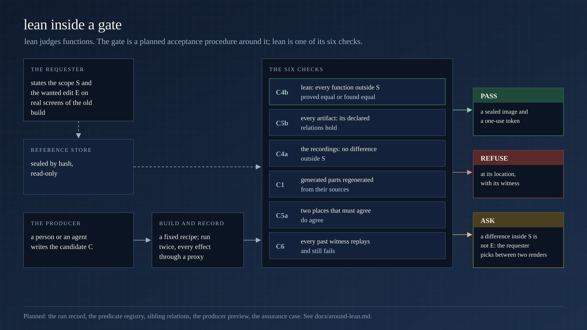

# Around lean: the architecture it sits in

lean answers one question: do two versions of a function behave the same outside a declared scope? This page is the layer above it: lean's state, the parts of a program it threads one contract at a time, the gate that would use it as one check among six, and the coding agent's loop as a research setting. The design source is [`langs/ts/design/research-integration.md`](../langs/ts/design/research-integration.md), sections 1, 2 and 11.

## What settles a claim

A claim about a change is settled only by a check that can fail, and every check states what it covered.

- **A proof** (lane A): a theorem Dafny and Z3 checked, for every input and every world. It settles the claim.
- **A decided state space** (the finite lane): every click order from every prop value, explored to the end. It settles the claim for that component.
- **A witness** (lane B): an input on which the two versions differ, replayable. It settles the claim the other way.
- **A bounded run** (lane B): no difference within a stated bound. It does not settle the claim, and the verdict says so (`PASS-bounded`).
- **ASK**: nothing above holds, and the reason is named.

No model takes part. A producer's description of its own change never enters a verdict.

## One state object: the ledger

Both lanes read and write one state object, the ledger. Each component is a part of the world a function can touch:

| component | holds |
|---|---|
| heap | records, arrays, dictionaries, Map, Set and Date cells, class instances |
| cells | module variables and the variables a closure captures |
| callables | a function value: its code identity and the cells it captured |
| pending | timers, intervals, promise reactions, events |
| clock | the instant a read returns |
| library | every built-in call as a transition on the ledger |

**Obligations.** For each function the translator lists the ledger components it touches. A function is provable when every one of them has a transition model. A touched component with no model is an obligation: lean says `ASK:obligation` and names it, and lane B still runs. `REFUSE` stays for what no model can carry (interception, code built from strings, a prototype changed after it escaped). The state-completeness audit that writes these obligations is built.

## The four worlds

Four parts of real programs are worlds lean must thread before it can judge them. The remedy each time: one testable contract, its bound or layer in the certificate, and `unknown` where it does not apply.

| world | what it adds | the contract | the boundary in the certificate |
|---|---|---|---|
| framework | decorators and their metadata are shared state | a decorator table keyed by package and export, each row with a fixture run against the framework; a metadata cell | only listed exports are modelled; an unknown decorator stays `ASK:interface` |
| concurrency | a second call can arrive while the first waits | scheduled promises, two callers on one receiver, only the orders that swap two dependent accesses | complete only within the declared bound: live calls, preemptions, the event model |
| front end | "the same screen" depends on a layer | the tree to a depth with context, then styles under a pinned Tailwind configuration, layout apart | each layer its own verdict; an unread style is `unknown`, never equal |
| refactors | a change spans several functions | relational summaries of changed callees, used at the call sites; an explicit adapter for a changed signature | a caller's proof rests on its callees' proved relations, named in the certificate |

Each row has a first version with a pair test today. Layout, pixels and accessibility stay outside any equality verdict.

## The gate around lean

A change to a system also touches what is not a function: a cache key that omits an input, a file missing from an asset list, a partial locale. The gate is the planned acceptance procedure around lean:

- the requester states the scope and the wanted outcome on real screens of the old build;
- the producer, a person or an agent, writes the candidate;
- the gate builds it with a fixed recipe and records it twice under fixed stimuli, every effect through a proxy;
- six checks run, and lean is one of them (C4b: every function outside the scope);
- a pass seals a read-only image with a one-use token; a refusal names its location and its witness; a difference inside the scope that is not the wanted outcome goes back to the requester as two renders to pick from.

Picking between two renders is the only human judgment in it. Planned with it: an append-only record per run, predicates per kind of artifact (a key added to one locale exists in its siblings), a preview of what the gate will check on a draft, and an assurance case naming the test behind each guarantee. A release broker and an effect proxy come only if the gate ships as a product.

## The coding agent's loop as a research setting

An agent that writes code needs a judge that is not itself. The planned setting:

- the gate as five tools with fixed input and output schemas: `preview`, `check_unit`, `check_artifact`, `witnesses`, `submit`;
- a reference loop with guards: rounds per function, a time budget per request, a named stop;
- every claim the agent records about behaviour runs through `check_unit` before it may submit;
- refusals as structured records;
- a witness library: an input that once revealed a defect is replayed on every later run.

The result to publish is a measured difference between the loop with the gate and without it. Built today: the lint's work list (`--agent`), `check.mjs` per function, and a `WITNESS` that carries the source line on each side with the advised rewrite, as the [README](../README.md#5-a-coding-agents-loop) shows.
