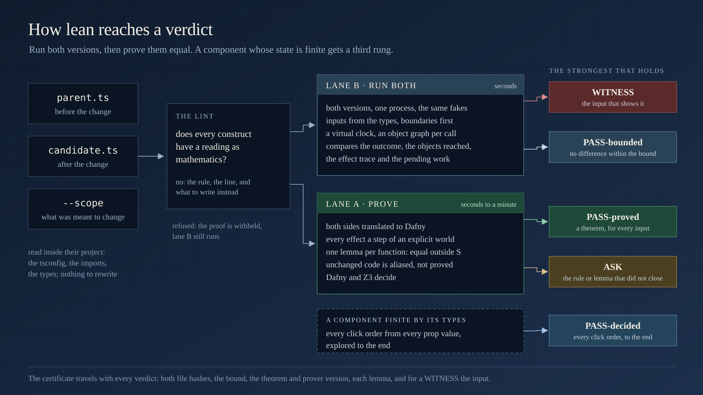

# How lean works, in full

The README shows what lean does with one picture per idea; this page keeps the full account of each lane, what "equal" means, the certificate, and the table of what lean reads today. The construct-by-construct reference is [`../langs/ts/subset.md`](../langs/ts/subset.md); the semantics is [`../langs/ts/SEMANTICS.md`](../langs/ts/SEMANTICS.md).

## The lanes

**The lint decides what has a reading.** A function is inside the subset when every construct in it has a meaning as mathematics. The lint names the first construct that does not, with its line, its rule and what to write instead. A function outside the subset still runs in lane B; only the proof is withheld.

**Lane B, bounded execution.** Both versions load in one process, each in its own sandbox, against the same fakes: every import that leaves the package, every global that reaches outside, every field of a receiver. Inputs come from the parameter types and from the values the code compares against, boundary values first, recursive shapes unfolded, objects sometimes shared between positions. A fake records what is asked of it and answers from the seed and the path, the same on both sides, so two runs disagree only where the code disagrees. After each call lane B compares four things: the outcome (the value returned or the value thrown), the object graph reachable from the arguments and the receiver, the ordered trace of effects with their answers, and the pending work (promises unsettled, timers armed, jobs queued). Every call of a library operation made from the unit's files is checked against the library table; a synchronous loop that never ends is a timeout under a watchdog, never a hang.

**Lane A, the proof.** The translator turns both sides into Dafny: a pure function becomes a function; a loop becomes a recursive helper with its termination measure; an effectful call takes the world and returns the next one; a parameter the function changes is returned beside the result; plain records and arrays live in a heap the function threads; a component is a function of its props and its hook slots. `spec/theorem.py` writes one lemma per changed function: outside the scope, `f_parent(x) == f_candidate(x)` for every input, every world and every fuel. Code whose text is identical on both sides is aliased, not proved. A changed function that calls other changed functions is proved through their proved relations, and a recursive cycle by induction on its fuel. Dafny and Z3 decide the rest.

**The finite lane, for components.** When a component's hook slots and props are finite by their types, `exec/finite.mjs` steps the parent and the candidate together through every click order from every prop assignment, effects and timers inside each step, to the end of the state space. `check.mjs` reports the strongest rung that holds.

**What "equal" means** is stated in full in [`langs/ts/SEMANTICS.md`](../langs/ts/SEMANTICS.md). Two versions are equal outside the scope when, for every input outside it and every world, the four observations are identical up to a renaming of fresh objects. The one axiom: an effect is a transition of a world. It is stated, not hidden. The hole most equivalence tools fall into (`readClock() === readClock()` proved equal to `true`) is closed by construction, since two reads of the clock are two transitions.

**The certificate** travels with every verdict: the unit, the hash of each side, lane B's bound (inputs, seed, time limit, the fake policy, the observation layer), lane A's lemmas with the theorem's hash and the prover version, the library records the run checked, and for a WITNESS the input and both observations side by side.

## What it reads

TypeScript today; each language fills its own table. The reading words: **exact** (a Dafny value of the same meaning) · **transition** (a step of an explicit world) · **uninterpreted** (the same unknown on both sides) · **opaque** (one transition named by the block's text) · **refused** (named, with what to write instead).

| area | what lean reads today |
|---|---|
| **values** | records, arrays, tuples, strings (UTF-16 code units, the common methods exact), sets, maps, optionals, literal unions, tagged unions, generics with their constraints, `null` and `undefined` as distinct absences, `typeof` and `instanceof` exact by static type, `any` with absence as its own value and one Dafny type per branch of a conditional |
| **numbers** | integers, reals per file (a float literal or a bare `/` makes the file real), `Math.floor`, `min`, `max`, `abs`, `%`, finite bitwise operations, `**` uninterpreted |
| **control** | loops as recursive helpers with their own termination measure, counted `for` loops and their desugared forms, a loop that only guards and pushes into a local array as a filter and a map, labelled `break` and `continue`, `switch` with fall-through, early returns, `do … while`, recursion on a fuel the loop helpers share, scalar generators as sequences |
| **operators** | assignment, update and comma values in evaluation order, `??=`, `\|\|=`, `&&=`, mixed-type `&&` and `\|\|` with the deciding operand evaluated once, spread into outside calls, rest parameters, record rest |
| **effects** | every call that leaves the file is a transition of an explicit world: injected services, imported functions, clocks (`Date`, `performance.now`, `hrtime` as ordered reads), `Math.random`, module loaders, globals, `process` writes |
| **exceptions** | `try`/`catch`/`finally` exact: a transition may fault, the catch path is a branch; a throw crosses same-file calls and callbacks; `finally` runs on every completion |
| **async** | `async`/`await` in order, `.then` and `.catch` chains as continuations, `new Promise` with a terminal executor, `Promise.all` over a `map` as a collecting loop, async iterators as world steps; a promise is a handle with an identity, so a `Promise<void>` returned is never a constant |
| **classes** | methods as functions of an explicit receiver, fields any method assigns live in the world, constructors, `super(...)` and `super.m()` as transitions, getters and setters as units, static members, decorators as transitions, same-file `new C()`, a free function's declared `this` as a receiver it may write |
| **functions as values** | a lambda is a pure value when its body is pure, else an opaque value keyed by its text; same-file functions and local procedures as callbacks; effectful callbacks to `map`, `forEach`, `filter` as ordered loops that may write the enclosing function's locals; a block callback's `return` is its own value; a callback's element may be destructured or defaulted; a callback that throws faults the loop |
| **references (the heap)** | a parameter the function changes is an output; plain records and arrays live in a heap the proof carries; whole-heap equality is the identity certificate, and a canonical reading proves equality up to a renaming of fresh cells and dropped allocations; an identity guard withholds a value proof when sharing could interfere |
| **the library** | `push`, `unshift`, `pop`, `shift`, `splice`, `reverse`, `slice`, `concat`, `map`, `filter`, `sort` with a comparator, the string methods, `Map` and `Set` with their insertion order (`keys`, `values`, `entries`, spread, `for … of`), `Array.from`, `Object.keys` of a dictionary, as transitions of a versioned table validated against the engine on every run and against Test262 |
| **objects and keys** | own keys against prototype keys: `in` and `hasOwnProperty` read exactly on records and dictionaries; a `Map` is never a dictionary; `Object.create(null)`, `__proto__` members and, in a file that makes its own prototype, the units the made object can reach are refused by name |
| **React** | JSX is a value tree; hooks are slots in call order; handlers are descriptors of their deferred setter calls or opaque values; effects with deps, cleanup and order; `useMemo` and `useCallback` exact; same-package children rendered to a stated depth under `--deep=k`, each `useContext` read from the nearest provider above it; a `className` as declarations under a pinned Tailwind table; Suspense as `ASK`; the Rules of React as refusals (`hook-order`, `render-impure`) plus a double render |
| **time** | a virtual clock: timeouts, intervals, immediates, animation frames and idle callbacks fire in due order after the call; a cleared timer is nothing; pending work is part of the observation |
| **modules** | dynamic `import()` and `require()` as opaque handles, module constants by their initializers, module cells as world transitions, path aliases resolved from the project, `process.env` and globals as reads of the world |

The full table, construct by construct, with its reading and an example, is [`langs/ts/subset.md`](../langs/ts/subset.md). The coverage matrix over every concept of the language is [`langs/ts/COVERAGE.md`](../langs/ts/COVERAGE.md). Each reading has a design note under [`langs/ts/design/`](../langs/ts/design/) with the pair test that pins it and the census that measured it.

What is refused, by name, because no value model keeps the axiom true: `eval` and `new Function`, the prototype chain (`Proxy`, `Reflect` beyond the decorator table's metadata, `Object.create`, `defineProperty`, `setPrototypeOf`), `super` as a value, `===` on two objects, mutation through an alias of a parameter, a callback handed away that writes an outer variable, a Date setter, an `Object.assign` into an argument. Each refusal names the line and what to write instead.

## The verdict ladder

| verdict | what it means | what backs it |
|---|---|---|
| **`WITNESS`** | the two versions behave differently, and here is the input or the click sequence | both observations, side by side, replayable |
| **`PASS-proved`** | equal on **every** input, every world and every fuel, outside the declared scope | a theorem checked by [Dafny](https://dafny.org) and Z3: its hash, the prover version, each lemma |
| **`PASS-decided`** | a component whose state and props are finite by its types: equal on **every** click order, explored to the end | the state pairs visited, the prop assignments, the handlers fired |
| **`PASS-bounded`** | no difference found on *n* generated inputs and click sequences under a frozen world | *n*, the seed, the fake policy, the sequence depth, the time limit |
| **`ASK`** | undecided, and exactly why | the construct, the lemma that did not close, the timeout, the changed interface |
| `REFUSE` | a construct with no faithful reading (named), or a local import that cannot load | the rule, or the loader error |
| `NEW` | a unit with no parent, loaded and run on drawn inputs | inputs, seed, fakes, faults, trace shapes; no equality claim |

The verdict is the strongest statement the evidence supports. A bounded pass never becomes a proof. In the literature this is a *regression verifier*; the ideas come from translation validation and differential testing, the engineering is ours.
