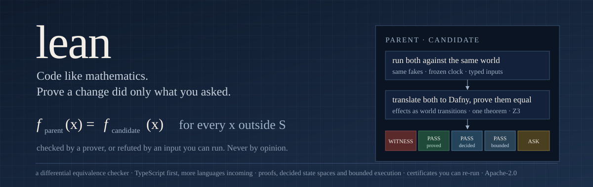
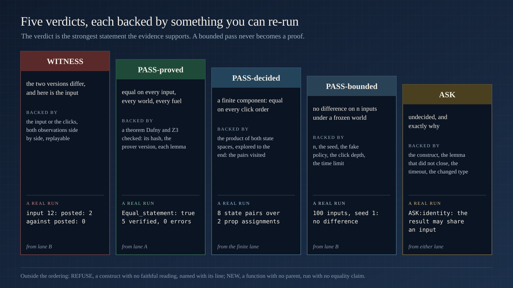
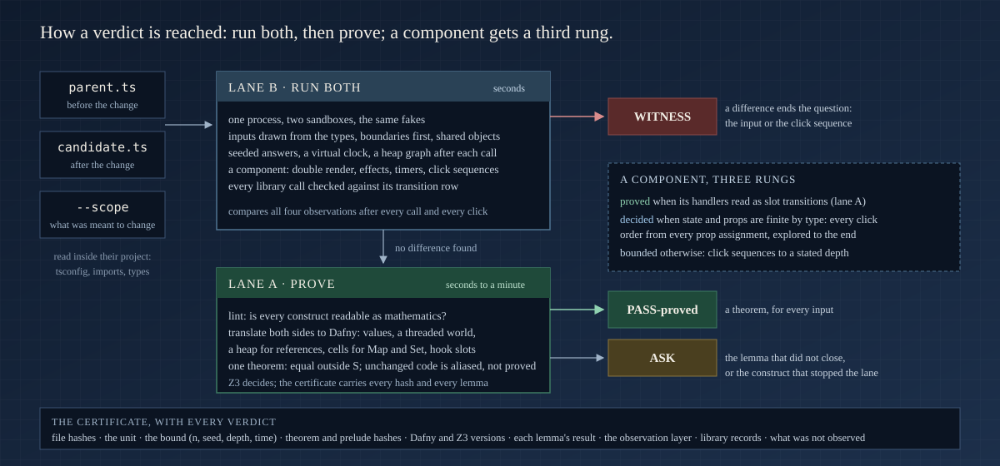
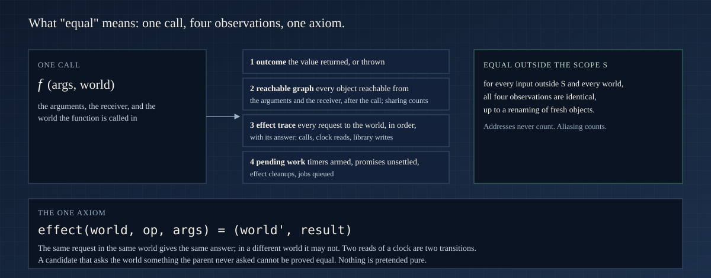
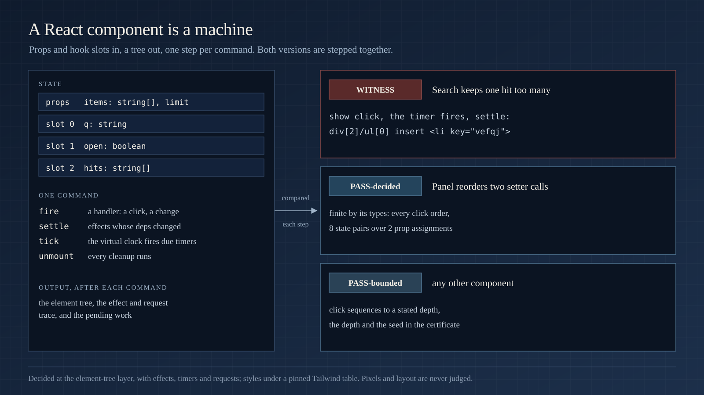

<p align="center">
  
</p>

<p align="center">
  <a href="#the-verdicts">Verdicts</a> ·
  <a href="#what-it-reads">What it reads</a> ·
  <a href="#examples">Examples</a> ·
  <a href="#how-it-works">How it works</a> ·
  <a href="#writing-code-lean-can-prove">Writing provable code</a> ·
  <a href="#using-it">Using it</a> ·
  <a href="#numbers">Numbers</a> ·
  <a href="#limits">Limits</a> ·
  <a href="#what-is-next">What is next</a>
</p>

---

**lean is a differential equivalence checker.** Give it the old version and the new version of a function, and the scope of what was meant to change. It decides whether the two behave the same everywhere else: by proof when it can, by exhaustive exploration when the state is finite, by execution when it must, and it says which.

TypeScript is the first language. The core (the theorem, the checker, the certificate, the conformance suite) is language-agnostic; each language adds a lint, a translator and an execution harness under `langs/`, and merges when it passes the same conformance run. Python is at milestone 1: typed functions, dataclasses and plain classes over ints, strings, lists, tuples, dicts and optionals, with calls into the outside as transitions of the world and raised exceptions as faults ([`langs/py/subset.md`](langs/py/subset.md)).

Every change to a program is a claim: *I changed this, and nothing else.* Tests sample that claim. Review guesses at it. lean checks it.

- **Nothing to rewrite.** It reads your TypeScript as it is, inside its project: the `tsconfig.json`, the imports, the types. No annotations, no wrapper library, no build step.
- **Nothing to trust.** Every verdict carries a certificate you can re-run: hashes, the theorem, the prover version, the inputs, the bound. No verdict comes from a model's opinion; no `assume` anywhere a proof can see.
- **Whole programs, not toy functions.** Services with injected ports, async pipelines, exceptions across calls, classes, generators, references into shared objects, Map and Set cells, timers, React components with hooks and effects.

```bash
git clone https://github.com/NexusGPT/lean && cd lean     # node ≥ 20 for lane B; python3 and dafny ≥ 4 (brew install dafny) for the proof lane
node langs/ts/check.mjs --parent old/feed.tsx --candidate new/feed.tsx --unit Feed
```

```json
{ "verdict": "WITNESS",
  "witness": { "input": 0, "sequence": ["div[0]:onClick", "div[0]:onClick"],
               "where": { "field": "sequence", "command": "div[0]:onClick" } },
  "certificate": { "unit": "Feed", "parent": { "sha256": "…" }, "candidate": { "sha256": "…" },
                   "observation": { "layer": "element tree", "renders": "one, then command sequences of up to 2 clicks", "…": "…" },
                   "lanes": { "B": { "verdict": "WITNESS", "bound": { "n": 200, "seed": 1, "ms": 2000, "…": "…" } } } } }
```

That is a React component whose candidate reads a stale closure. One render and one click look identical; the second click does not. lean found the two-click sequence itself.

## The verdicts

<p align="center"></p>

| verdict | what it means | what backs it |
|---|---|---|
| **`WITNESS`** | the two versions behave differently, and here is the input or the click sequence | both observations, side by side, replayable |
| **`PASS-proved`** | equal on **every** input, every world and every fuel, outside the declared scope | a theorem checked by [Dafny](https://dafny.org) and Z3: its hash, the prover version, each lemma |
| **`PASS-decided`** | a component whose state and props are finite by its types: equal on **every** click order, explored to the end | the state pairs visited, the prop assignments, the hash of the visited set |
| **`PASS-bounded`** | no difference found on *n* generated inputs and click sequences under a frozen world | *n*, the seed, the fake policy, the sequence depth, the time limit |
| **`ASK`** | undecided, and exactly why | the construct, the lemma that did not close, the timeout, the changed interface |
| `REFUSE` | a construct with no faithful reading (named), or a local import that cannot load | the rule, or the loader error |
| `NEW` | a unit with no parent, loaded and run on drawn inputs | inputs, seed, fakes, faults, trace shapes; no equality claim |

The verdict is the strongest statement the evidence supports. A bounded pass never becomes a proof. In the literature this is a *regression verifier*; the ideas come from translation validation and differential testing, the engineering is ours.

## What it reads

TypeScript today; each language fills its own table. A function is inside the subset when every construct in it has a reading as mathematics. Then it gets a proof. Everything else still runs in lane B and gets a bounded verdict with the exact rule that stopped the proof. The reading words: **exact** (a Dafny value of the same meaning) · **transition** (a step of an explicit world) · **uninterpreted** (the same unknown on both sides) · **opaque** (one transition named by the block's text) · **refused** (named, with what to write instead).

| area | what lean reads today |
|---|---|
| **values** | records, arrays, strings (UTF-16 code units, the common methods exact), sets, maps, optionals, literal unions, tagged unions, generics, `null` and `undefined` as distinct absences, `typeof` and `instanceof` exact by static type |
| **numbers** | integers, reals per file (a float literal or a bare `/` makes the file real), `Math.floor`, `min`, `max`, `abs`, `%`, finite bitwise operations, `**` uninterpreted |
| **control** | loops as recursive helpers with their own termination measure, labelled `break` and `continue`, `switch` with fall-through, early returns, `do … while`, recursion with fuel, scalar generators as sequences |
| **operators** | assignment, update and comma values in evaluation order, `??=`, `||=`, `&&=`, mixed-type `&&` and `||` with the deciding operand evaluated once, spread into outside calls, rest parameters, record rest |
| **effects** | every call that leaves the file is a transition of an explicit world: injected services, imported functions, clocks (`Date`, `performance.now`, `hrtime` as ordered reads), `Math.random`, module loaders, globals |
| **exceptions** | `try`/`catch`/`finally` exact: a transition may fault, the catch path is a branch; a throw crosses same-file calls; `finally` runs on every completion |
| **async** | `async`/`await` in order, `.then` and `.catch` chains as continuations, `new Promise` with a terminal executor, `Promise.all` over a `map` as a collecting loop, async iterators as world steps |
| **classes** | methods as functions of an explicit receiver, fields any method assigns live in the world, constructors, `super(...)` and `super.m()` as transitions, getters and setters as units, same-file `new C()` |
| **functions as values** | a lambda is a pure value when its body is pure, else an opaque value keyed by its text; same-file functions and local lambdas as callbacks; effectful callbacks to `map`, `forEach`, `filter` as ordered loops |
| **references (the heap)** | a parameter the function changes is an output; plain records and arrays live in a heap the proof carries; whole-heap equality is the identity certificate; an identity guard withholds a value proof when sharing could interfere |
| **the library** | `push`, `unshift`, `pop`, `shift`, `splice`, `reverse`, `slice`, `concat`, `map`, `filter`, `Map.set/get/has/delete`, `Set.add/has/delete` as transitions of a versioned table, validated against the engine on every run and against Test262 |
| **React** | JSX is a value tree; hooks are slots in call order; handlers are descriptors of their deferred setter calls or opaque values; effects with deps, cleanup and order; `useMemo` and `useCallback` exact; Suspense as `ASK`; the Rules of React as refusals (`hook-order`, `render-impure`) plus a double render |
| **time** | a virtual clock: timeouts, intervals, immediates, animation frames and idle callbacks fire in due order after the call; a cleared timer is nothing; pending work is part of the observation |
| **modules** | dynamic `import()` and `require()` as opaque handles, module cells as world transitions, `process.env` and globals as reads of the world |

The full table, construct by construct, with its reading and an example, is [`langs/ts/subset.md`](langs/ts/subset.md). The coverage matrix over every concept of the language, with the unit count each one holds in 39 real repositories, is [`langs/ts/COVERAGE.md`](langs/ts/COVERAGE.md).

What is refused, by name, because no value model keeps the axiom true: `eval` and `new Function`, the prototype chain (`Proxy`, `Reflect`, `Object.create`, `defineProperty`, `setPrototypeOf`), `super` as a value, `===` on two objects, mutation through an alias of a parameter, a callback that writes an outer variable, a Date setter, an `Object.assign` into an argument. Each refusal names the line and what to write instead.

## Examples

Every output below is a real run of this checkout (single units with `--n 60 --no-project`, the pull request with `pr.mjs`'s defaults); the pairs live under [`langs/ts/tests/pairs/`](langs/ts/tests/pairs/) and the suite checks them on every commit.

### 1. A pull request: one slip, two refactors, one asked change

[`examples/booking/`](examples/booking/) is a pricing core and a quote service at the shape of a real price-comparison app: shops in zones, per-shop prices with validity days, two kinds of promotion, carts, delivery fees, a service with injected ports. Commit `85136f1` changed it the way a real pull request does: one asked rule (percent promotions capped at half the unit price), one slip while there (`>=` became `>` in the free-delivery test), two refactors that keep behaviour.

```bash
node langs/ts/pr.mjs --repo . --base 85136f1~1 --head 85136f1 --scope unitDiscount
```

| file | function | verdict | lane B | lane A | note |
|---|---|---|---|---|---|
| pricing.ts | `unitDiscount` | **IN-SCOPE** | PASS-bounded | | declared in scope |
| pricing.ts | `deliveryFee` | **WITNESS** | WITNESS | | input 11: outcome |
| pricing.ts | `formatCents` | **PASS-proved** | PASS-bounded | PASS-proved | the refactor is a theorem |
| service.ts | `cleanCart` | **PASS-bounded** | PASS-bounded | ASK:identity | the loop was reshaped; no difference on 100 inputs; the result may share an input, so the value proof is withheld |

The slip comes with the input that shows it. The refactor is proved for every input. The reshaped loop gets a bound and the reason, not a guess. Reviewers read the declared scope and the asks, not the diff.

### 2. A stale closure in a React handler, found after two clicks

```tsx
export function Feed({ start }: { start: number }) {
  const [id, setId] = useState(start);
  useEffect(() => { subscribe(id); return () => unsubscribe(id); }, [id]);
  return <div><button onClick={() => setId(id + 1)}>next</button><p>{id}</p></div>;
}
```

The candidate writes `setId(start + 1)`. One render is identical. One click is identical. The second click moves the parent to `start + 2` while the candidate stays at `start + 1`, and the parent's effect cleans up and re-subscribes once more.

```
WITNESS   sequence: ["div[0]:onClick", "div[0]:onClick"]   where: { field: "sequence", command: "div[0]:onClick" }
```

Lane B re-renders from a fresh mount along every command sequence of up to two clicks over at most four handlers, settling effects by `Object.is` on their deps, cleanup first, and firing armed timers through the virtual clock.

### 3. A finite component, decided for every click order

```tsx
export function Toggle({ initial }: { initial: boolean }) {
  const [open, setOpen] = useState(initial);
  const [pinned, setPinned] = useState(false);
  return (
    <div>
      <button onClick={() => { setOpen(!open); if (!open) setPinned(true); }}>{open ? "close" : "open"}</button>
      <button onClick={() => setPinned(!pinned)}>{pinned ? "pinned" : "free"}</button>
      {open && pinned && <p>both</p>}
    </div>
  );
}
```

The candidate reorders the two setter calls inside the first handler. The proof lane cannot read a handler with a branch, so it says `ASK:identity`. The state is two booleans and one boolean prop: finite by its types. Lane B steps the parent and the candidate together over every click order from every prop value, effects and timers inside each step.

```
PASS-decided   renders: "every click order from every prop assignment, decided: 8 state pairs over 2 assignment(s)"
               finite: { slots: [2, 2], props: ["initial:2"], assignments: 2 }      0.7 s
```

The sibling `Mutant` writes `setPinned(true)` for `setPinned(!pinned)`: a `WITNESS` after two clicks on the second button, `{ initial: true }`, sequence `["div[1]:onClick", "div[1]:onClick"]`.

### 4. A counter proved over its hook slots

```tsx
export function Counter({ start }: { start: number }) {
  const [n, setN] = useState(start);
  return <button onClick={() => setN(n + 1)}>{n}</button>;
}
```

The candidate writes `setN(1 + n)`. Lane A reads the component as a function of its props and its slots: the render reads slot 0, the handler is a `ReactSet(0, n + 1)` step, and the unit returns its initial slots. One lemma: equal props and slots give an equal tree and an equal next slot.

```
PASS-proved   lanes.A: { lemmas: { Equal_counter: true }, dafny: "finished with 1 verified, 0 errors",
                         theoremSha256: "16836545d2e6197e", dafnyVersion: "4.11.0", timeLimitSeconds: 60 }
```

The sibling that writes `setN(n + 2)` is refuted by the prover and witnessed by lane B after one click. A functional updater against the value form: proved. A lazy initializer against the eager one: proved.

### 5. A timer's callback, observed when the clock fires

```ts
export function later(port: Port): number { setTimeout(() => port.send("x"), 100); return 1; }
```

The candidate sends `"y"`. The return value is the same and the pending work looks the same, so one call shows nothing. After the call, lane B's virtual clock fires every armed timer once, in due order, and what each callback asks of the world lands in the trace.

```
WITNESS   where: { field: "trace", index: 2,
                   parent:    { op: "call", path: "arg0.send", args: ["x"] },
                   candidate: { op: "call", path: "arg0.send", args: ["y"] } }
```

A timer that is armed and cleared is nothing: a candidate that drops both is `PASS-bounded`. Two timers armed in the other order fire in due order, the same trace. A different interval is a different pending record: `WITNESS`.

### 6. References: a mutation proved as a heap transition, a slice refuted

```ts
export function flip(box: Box): string[] { box.names.reverse(); return box.names; }
export function head(box: Box): string[] { return box.names.slice(0, 2); }
```

The candidate's `flip` returns the receiver through a local (`const out = box.names; return out;`): `PASS-proved`, with `reverse` read from the library transition table as a step on the heap the proof carries, and the result's identity shown to be the input's. A `shift` for a `splice(0, 1)` leaves the same reachable graph but not the same heap, since `splice` allocates the removed part nobody keeps: the whole-heap lemma fails and the canonical reading proves it, equal up to a renaming of fresh cells and up to dropped allocations (`lanes.A.reading`), so allocation order and temporaries never cost a proof. The candidate's `head` slices three names for two:

```
WITNESS   input 1   args: [{ items: [{ id: 347, tags: ["vhn02", "vk85x"] }], names: [" ", "v20gs", "ve9vk", "x y"] }]   where: { field: "outcome" }
```

A `shift()` for a `splice(0, 1)` leaves the same reachable graph: `PASS-bounded` in lane B, and unproved under whole-heap equality because `splice` allocates the part it removed. That gap is named, and the canonical-heap certificate that closes it is on the list below.

The heap core reads real code: a method of a class takes `this` as a reference to the record of its fields, so a write to `this.count` is a step on the same heap. An element access `a[i]` is proved only where the code keeps its index in range, since JavaScript reads `undefined` outside it. A loop over an array is a recursive step on the heap, and a refactor around an unchanged loop body proves. A field that may be missing keeps apart a missing key and a key holding `undefined`, and a value read after a presence test is proved present.

### 7. An exception that crosses a call

```ts
export function leaf(x: number): number { if (x < 0) throw "bad"; return x; }
export function caller(x: number): number { try { return leaf(x); } catch (error) { return -1; } }
```

The candidate's `leaf` throws on `x <= 0`. Nothing in `caller` changed, but its catch path now runs on zero:

```
WITNESS   input 2   args: [0]   where: { field: "outcome" }
```

A throw is a fault raised on the world; it crosses same-file calls; `finally` runs on every completion; a `try` whose block the proof lane cannot read is one opaque transition named by its text, so the same block on both sides is the same transition and a changed one is never silently equal.

### More, from the suite

- `sumAll` doubling each awaited value inside `await Promise.all(ids.map(…))`: `WITNESS`; a sibling writing `put(id, 2)` for `put(id, 1)` inside the map: `WITNESS` (the map is read as a collecting loop).
- A generator refactored to yield the same sequence: `PASS-bounded`; a consumer whose producer's yields changed, and an async producer whose `next` transitions interleave differently with the consumer's effects: `WITNESS`.
- `slug` splitting on another literal: `WITNESS`; padding by a loop against the method: `PASS-proved`; a Unicode case change: `WITNESS`.
- Mixed-type `&&` and `||` with calls inside: defaults and explicit branches keep the transition order, `PASS-proved`; an unconditional call on the right side, or a duplicated call on the left, changes the order: `WITNESS`.
- `readClock() === readClock()` against `true`: **not provable**, as it must be.

## How it works

<p align="center"></p>

**Lane B, bounded execution.** Both versions load in one process, each in its own sandbox, against the same fakes: every import that leaves the package, every global that reaches outside, every field of a receiver. Inputs come from the parameter types, boundary values first, recursive shapes unfolded, objects sometimes shared between positions. A fake records what is asked of it and answers from the seed and the path, the same on both sides, so two runs disagree only where the code disagrees. After each call lane B compares the four observations. A component is rendered twice from the same slots (Strict Mode's rule), its effects run, its handlers fire along command sequences, its timers fire through the virtual clock, in every order the event loop allows when up to three are due at one instant. Every call of a library-table operation made from the unit's files is recorded and checked against its row; a row the engine contradicts is a defect of the table, never of the unit. A synchronous loop that never ends is a timeout under the vm watchdog, never a hang.

**Lane A, the proof.** The lint decides whether every construct has a reading. The translator turns both sides into Dafny: a pure function becomes a function; a loop becomes a recursive helper with its termination measure; an effectful call takes the world and returns the next one; a parameter the function changes is returned beside the result; plain records and arrays live in a heap the function threads; a component is a function of its props and its hook slots. `spec/theorem.py` writes one lemma per changed function: outside the scope, `f_parent(x) == f_candidate(x)`. Code whose text is identical on both sides is aliased, not proved. Dafny and Z3 decide the rest.

**The third rung, for components.** When a component's slots and props are finite by their types, `exec/finite.mjs` explores the product of the parent's and the candidate's state spaces over every click order from every prop assignment: `PASS-decided`. Readable handlers get the proof; unbounded slots get the bounded sequences. `check.mjs` reports the strongest rung that holds.

<p align="center"></p>

**What "equal" means** is stated in full in [`langs/ts/SEMANTICS.md`](langs/ts/SEMANTICS.md). One call observes the outcome, the reachable object graph after the call, the ordered effect trace with its answers, and the pending work. Two versions are equal outside the scope when, for every input outside it and every world, the four are identical up to a renaming of fresh objects. The one axiom: an effect is a transition of a world. It is stated, not hidden. The hole most equivalence tools fall into (`readClock() === readClock()` proved equal to `true`) is closed by construction.

<p align="center"></p>

**A component is a machine.** Its state is the hook slots in call order plus the props; a command is a fired handler, a settle, a tick of the clock or an unmount; its output after each command is the element tree, the effect and request trace, and the pending work. lean decides at the element-tree layer and says so in every front-end certificate (`observation.layer`, what was rendered, what was not observed). A WITNESS at the element-tree layer is printed as the patch from the parent's tree to the candidate's: the nodes inserted, removed and moved (matched by key), the text and the attributes that changed. The committed DOM, styles, layout, pixels and the accessibility tree need a browser; no proof exists for them in any field we read, so lean never claims one. Lane B's hook runtime agrees with React-tRace's formal semantics on 8 of 8 ported scenarios (setter during render, effect loops, the 25-retry limit, a module counter, two user clicks).

## Writing code lean can prove

The rule in one line: **a function owns what it creates, and everything else flows through its arguments, its result, and the world.** Each habit removes one thing that has no place in the mathematical reading, and lean names the habit it needs (`ASK: <rule>`) instead of guessing.

| you write | lean says | write instead | what it buys |
|---|---|---|---|
| `const t = user.tags; t.push(x)` | `alias-mutation` | `user.tags.push(x)`: change it through the parameter, which becomes an output | a candidate that appends twice or to the wrong record returns a different `user'`, for every input |
| `a === b` on two objects | `reference-equality` | compare the fields you mean | a value equality the verifier decides |
| `while (i > 0) { … }` with no measure | opaque block | `// @decreases i` above the loop | a change inside the loop is proved or refuted, never silently equal |
| `this.client.state.n += 1` through a class instance | `receiver-mutation` | keep receiver paths as data records: `this.stats = { ...stats, n: stats.n + 1 }` | each read and write is a transition the proof sees |
| `Object.assign(user, patch)` | `assign-target` | `{ ...user, ...patch }` | the target's new value is in the model (the table row that models `assign` itself is next) |
| `on && change(xs)` | `conditional-effect` | `if (on) change(xs)` | a branch returns its world and value only when selected |

Everything else is yours: `async`/`await`, `try`/`catch`, `switch`, destructuring with defaults, optional chaining, template strings, `Set`, `Map`, generics, recursion, early returns, callbacks to array methods, local lambdas, JSX. The long form, the eight habits with what each one buys and why screens and pointers read as mathematics, is [`docs/writing-provable-code.md`](docs/writing-provable-code.md).

**In the editor.** The ESLint plugin (`langs/ts/eslint`) ships one rule, `lean/provable`. It runs lean's own lint on the file inside its project, so what the editor underlines is exactly what the proof lane will refuse: the line, the rule, what to write instead; a rewrite that keeps your meaning is offered as a suggestion. The same lint runs from the command line, and `--agent` prints a work list a coding agent can act on, item by item.

```
$ node langs/ts/lint/lint.mjs src/users.ts
src/users.ts:4:3   alias-mutation      `tags` is another name for a value this function was handed; change it through that name, or copy it first
src/users.ts:9:58  reference-equality  === on arrays and records compares references; compare fields
2 violation(s)
```

Code written with the lint on is inside the subset from the first line. Code written before it: 60.0 percent of 48,696 real functions and methods across 39 repositories are inside as written; the rest get lane B and the rule that stopped the proof lane.

## Using it

| | command |
|---|---|
| one function, both lanes, one verdict with its certificate | `node langs/ts/check.mjs --parent old.ts --candidate new.ts --unit applyDiscount` (`--unit PricingService.applyDiscount` for a method; `--scope scope.json`; `--n`, `--seed`, `--dafny-seconds`) |
| a whole pull request, one table | `node langs/ts/pr.mjs --repo <checkout> --base <ref> [--head <ref>] [--scope f,Class.m] [--out report.md] [--json report.json]` |
| lane B alone, in seconds | `node langs/ts/exec/run.mjs --parent old.ts --candidate new.ts --unit f [--sequence-depth 2 --sequence-breadth 4]` |
| the gate, in the editor or the terminal | `node langs/ts/lint/lint.mjs file.ts [--json \| --agent] [--changed ranges.json]` · `import lean from 'lean/langs/ts/eslint/index.mjs'` |
| the suite | `node langs/ts/tests/run.mjs` (1,419 checks on the current head, all pass) · `python3 -I conformance/run.py` |

**Scope is optional.** Without it, every changed function of a pull request is judged and a difference is a `WITNESS`. With it, a function you name as meant to change reports `IN-SCOPE` with its lane B result: its difference is information, not a finding. Scope is declared, never inferred: function names, input predicates over the parameters, effect operations allowed to change. The producer of a change is never consulted.

**Lane B needs only Node** (fast-check, which draws and shrinks its environment programs, is vendored under `langs/ts/vendor` with its licence). Dafny and Python are needed for the proof lane alone; without them every verdict is lane B's (`WITNESS`, `PASS-decided`, `PASS-bounded`, `ASK`) and the certificate says the proof lane did not run.

A pull request then carries, per changed function, one verdict and its certificate; `WITNESS` comes with the input or the click sequence, `PASS-proved` with a theorem anyone can re-check.

**In CI.** [`langs/ts/ci/comment.mjs`](langs/ts/ci/) posts that table as one pull-request comment, updated on every push, and the reusable workflow [`.github/workflows/lean-pr.yml`](.github/workflows/lean-pr.yml) runs it from a caller of a few lines, blocking nothing until the caller asks ([`langs/ts/design/ci.md`](langs/ts/design/ci.md)).

### Try it on your own repository

1. **Shadow run.** Take the last twenty or thirty merged pull requests and run `pr.mjs` on each (`--base <merge base> --head <merge commit>`), without scope. Nothing blocks; you read tables.
2. **Read three things.** The share of `ASK` and the rules behind it (each names what to write instead); whether any `WITNESS` lands on a slip that reached production; how often the changed function was the one meant to change, which is what scope would have said.
3. **Then a comment, then a gate.** Post the table as a non-blocking comment on new pull requests. Turn on the ESLint rule for new code once the `ASK` share on your repository is one you accept. Make `WITNESS` blocking last.

## Numbers

Measured on a corpus of 39 production TypeScript repositories, private and public. Numbers, not code and not names, are published; every row names its date and its source.

| measurement | result |
|---|---|
| real functions inside the subset as written (39 repositories, 48,696 units, 2026-10-26) | **60.0 percent**; the rest get lane B and the rule that stopped the proof |
| the concept bench: 205 language concepts, 10 real units each from the corpus, planted mutants per unit (master `03ec3bc`, 2026-10-26) | 1,796 instances, 849 inside, 770 translated; **1,481 of 2,031 mutants witnessed** (72.9 percent); 1,494 of 2,034 on the development head `bf578a0` |
| the front-end mutation benchmark (30 corpus components with hooks, 6 mutation operators, re-run 2026-10-27 with click sequences, effects as slots and the virtual clock) | 71 applicable mutants, **44 caught** (62 percent; 40 at one render on 2026-10-26); per operator: text 15 of 20, flipped conditional 14 of 16, key-by-index 9 of 10, removed cleanup 2 of 5, dropped dep 3 of 11, swapped setters 1 of 9 (two setters reordered inside one handler is React batching, not an observation, so most of those are equal by design) |
| finite components in the corpus (1,037 components with `useState`) | 265 with every slot finite (26 percent); 98 to 100 finite in slots and props |
| the library transition table against the engine (Test262, 19 directories, 2026-10-26) | 996 files, 12,459 in-model records, **0 disagreements**; 2,814 records outside the model, named |
| lane B's hook runtime against React-tRace's semantics | **8 of 8** ported scenarios agree |
| the two-clock pair (`readClock() === readClock()` vs `true`) | **not provable**, as it must be |
| the test suite at the current head | **1,419 checks, all pass**; conformance 88 of 88 |

## Limits

lean says `ASK` rather than guess. Today it asks on: a `while` loop without a measure (an opaque block), a changed function that calls a changed recursive sibling (an induction the theorem does not yet write), a result that may share an input when the identity skeleton cannot be read (`ASK:identity`), a suspended render, a render loop, two asynchronous schedules racing (lane B runs one microtask order and says so), and code the repository does not contain. It refuses by name what no value model can carry: `eval`, the prototype chain, `super` as a value, identity comparison of objects. A changed TypeScript signature (a parameter type, a decorator on the method or a parameter) is `ASK:interface`, never a proof, even when the two Dafny signatures agree; a parameter rename alone is not a signature change.

Lane B's bound is real: a frozen world, generated inputs, one microtask order, click sequences to a stated depth. Its word is `PASS-bounded`, and it stays that word. The front end is decided at the element-tree layer; pixels, styles and layout are never judged, and the certificate says so. A child component is a name in the parent's tree with its props; under `--deep` a same-package child is rendered one level down inside the parent's run, on its own hook slots, and the certificate names the mode. A library hook listed in `translate/hooks.json` is a typed transition in lane A and a typed fake in lane B; an unlisted one is an opaque call.

## What is next

Built on 2026-10-26 and 27: the explicit world, classes, generics, JSX as a value, exceptions across calls, promises in every common form, generators, strings, bitwise numbers, operators as values, module forms, clocks as ordered reads, the heap (lane B's reachable graph and the proof lane's heap core with its identity guard), the library transition table with engine validation, Map and Set cells, the virtual clock, hook slots with re-render sequences, the double render, the finite-state lane, the React-tRace conformance run, the vm watchdog, the recorder of built-in calls.

On the board, in order:

- **Retained handles.** An escaped callback becomes a handle the environment program may invoke again, later, repeatedly; the witness is the program.
- **Callable records.** A function value as its code identity plus its captured cells, so two closures are equal when both agree.
- **The canonical heap.** Allocation order and garbage stop mattering (`shift` for `splice` becomes a theorem); idempotent cell writes proved.
- **The table grows.** `Object.assign` and `sort` with a pure comparator as transitions; `Object.freeze`, `structuredClone`, Date cells.
- **Heap enumeration in lane B.** Small heaps with sharing and cycles as inputs.
- **More languages.** Python first, under `langs/py`, through the same conformance suite: the theorem, the verdicts and the certificate do not change; the lint, the translator and the harness are the language's.

## Repository layout

```
langs/ts/check.mjs        one unit, both lanes, one verdict with its certificate
langs/ts/pr.mjs           a whole change: every changed function of a pull request, one table
langs/ts/lint/            the subset gate; advice per rule; the ESLint plugin lives in langs/ts/eslint
langs/ts/translate/       TypeScript → Dafny: the world, receivers, the heap core, the library table, hook slots
langs/ts/exec/            lane B: fakes, typed inputs, the differential runner, the virtual clock, the finite explorer,
                          the built-in call recorder, the React-tRace conformance run
langs/ts/SEMANTICS.md     what "equal" means, the one axiom, what stays outside
langs/ts/subset.md        every construct: exact, transition, uninterpreted, opaque, or refused
langs/ts/COVERAGE.md      every language concept against lean's reading, with corpus counts
langs/ts/design/          design notes, censuses, benchmarks and the research integration ledger
spec/theorem.py           the theorem: equal outside S; identity aliasing; prelude merge
conformance/              one command runs every language against every fixture
fixtures/                 shared behaviours, escapes the subset must refuse, clean changes it must pass
examples/booking/         a pricing core and a quote service written in lean style
langs/py/lint/            Python: the subset gate, the same rule names as TypeScript where the construct is the same
langs/py/translate/       Python → Dafny, the same core conventions: the world, faults, loops as measured helpers
langs/py/exec/            Python lane B: both sides in one process, recording stubs, typed inputs from the hints
langs/py/subset.md        the Python subset; langs/py/SEMANTICS.md, where Python's meaning differs
langs/_template/          how to add a language
```

## Contributing

A language merges when it passes `python3 -I conformance/run.py`: every shared fixture translates to the same form, every escape is refused, no clean change is refused. For TypeScript, `node langs/ts/tests/run.mjs` must stay green; a new construct comes with a pair test under `langs/ts/tests/pairs/` that shows the verdict it produces.

Rules that bind every contribution: no verdict from a model; no `assume`, no `{:axiom}`, no `{:verify false}` anywhere a proof can see; a bounded result is never reported as a proof; every mechanism is general, never a case for one bug.

## License

Apache-2.0.
