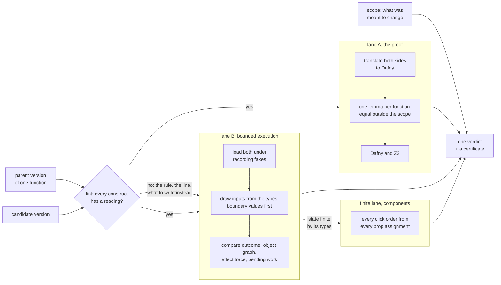
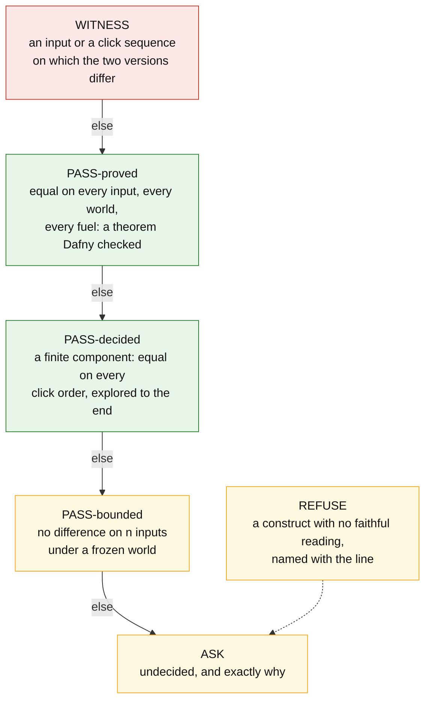
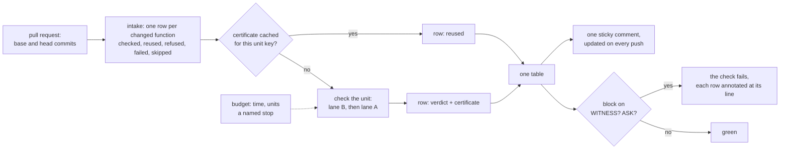
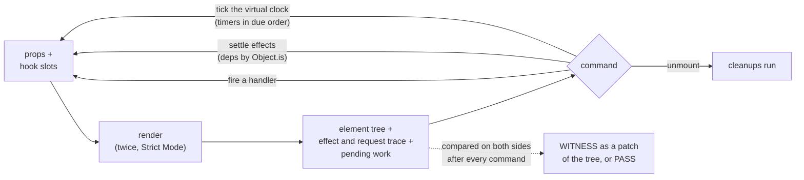
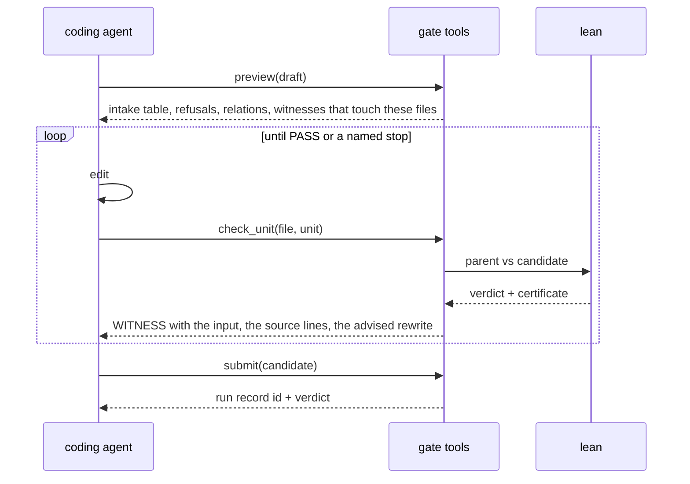
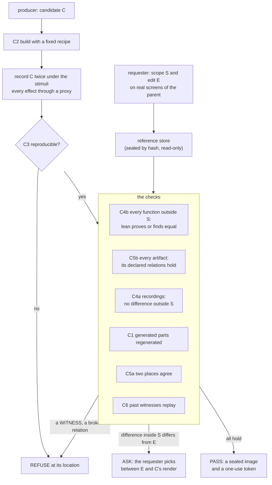

<p align="center">
  
</p>

<p align="center">
  <a href="#how-it-works">How it works</a> ·
  <a href="#the-verdicts">Verdicts</a> ·
  <a href="#what-it-reads">What it reads</a> ·
  <a href="#use-cases">Use cases</a> ·
  <a href="#writing-code-lean-can-prove">Writing provable code</a> ·
  <a href="#using-it">Using it</a> ·
  <a href="#what-is-built-and-what-is-planned">Built and planned</a> ·
  <a href="#limits">Limits</a>
</p>

---

**lean is a differential equivalence checker.** Give it the old version and the new version of a function, and the scope of what was meant to change. It decides whether the two behave the same everywhere else: by proof when it can, by exhaustive exploration when the state is finite, by execution when it must, and it says which.

Every change to a program is a claim: *I changed this, and nothing else.* Tests sample that claim. Review guesses at it. lean checks it, and hands back a certificate that anyone can re-run.

- **Nothing to rewrite.** It reads your TypeScript as it is, inside its project: the `tsconfig.json`, the imports, the types. No annotations, no wrapper library, no build step.
- **Nothing to trust.** Every verdict carries the hashes of both sides, the theorem and the prover version, or the inputs, the seed and the bound. No verdict comes from a model's opinion; no `assume` anywhere a proof can see.
- **Whole programs, not toy functions.** Services with injected ports, async pipelines, exceptions across calls, classes, generators, references into shared objects, Map and Set cells, timers, React components with hooks, effects and children.

TypeScript is the first language. The core (the theorem, the checker, the certificate, the conformance suite) is language-agnostic; each language adds a lint, a translator and an execution harness under `langs/`, and merges when it passes the same conformance run. Python is at its first milestone ([`langs/py/subset.md`](langs/py/subset.md)).

```bash
git clone https://github.com/NexusGPT/lean && cd lean     # node ≥ 20 for lane B; python3 and dafny ≥ 4 (brew install dafny) for the proof lane
node langs/ts/check.mjs --parent old/ledger.ts --candidate new/ledger.ts --unit applyAll
```

```
WITNESS   input 12   where: { field: "outcome" }
parent:    { returned: { posted: 2, rejected: [], total: -98 } }
candidate: { returned: { posted: 0, rejected: ["line one\nline two: below floor", "v6z8n: below floor"], total: -100 } }
```

That is a ledger function whose candidate rejects an event that lands exactly on the floor (`<=` where the parent had `<`). lean drew the input itself: one account at a negative balance, two credits that bring two new accounts exactly to the floor. The parent posts both and notifies the port twice; the candidate posts nothing. The whole example, with the five other functions of the file, is [below](#1-one-function-in-a-service-the-back-end).

## How it works



**The lint decides what has a reading.** A function is inside the subset when every construct in it has a meaning as mathematics. The lint names the first construct that does not, with its line, its rule and what to write instead. A function outside the subset still runs in lane B; only the proof is withheld.

**Lane B, bounded execution.** Both versions load in one process, each in its own sandbox, against the same fakes: every import that leaves the package, every global that reaches outside, every field of a receiver. Inputs come from the parameter types and from the values the code compares against, boundary values first, recursive shapes unfolded, objects sometimes shared between positions. A fake records what is asked of it and answers from the seed and the path, the same on both sides, so two runs disagree only where the code disagrees. After each call lane B compares four things: the outcome (the value returned or the value thrown), the object graph reachable from the arguments and the receiver, the ordered trace of effects with their answers, and the pending work (promises unsettled, timers armed, jobs queued). Every call of a library operation made from the unit's files is checked against the library table; a synchronous loop that never ends is a timeout under a watchdog, never a hang.

**Lane A, the proof.** The translator turns both sides into Dafny: a pure function becomes a function; a loop becomes a recursive helper with its termination measure; an effectful call takes the world and returns the next one; a parameter the function changes is returned beside the result; plain records and arrays live in a heap the function threads; a component is a function of its props and its hook slots. `spec/theorem.py` writes one lemma per changed function: outside the scope, `f_parent(x) == f_candidate(x)` for every input, every world and every fuel. Code whose text is identical on both sides is aliased, not proved. A changed function that calls other changed functions is proved through their proved relations, and a recursive cycle by induction on its fuel. Dafny and Z3 decide the rest.

**The finite lane, for components.** When a component's hook slots and props are finite by their types, `exec/finite.mjs` steps the parent and the candidate together through every click order from every prop assignment, effects and timers inside each step, to the end of the state space. `check.mjs` reports the strongest rung that holds.

**What "equal" means** is stated in full in [`langs/ts/SEMANTICS.md`](langs/ts/SEMANTICS.md). Two versions are equal outside the scope when, for every input outside it and every world, the four observations are identical up to a renaming of fresh objects. The one axiom: an effect is a transition of a world. It is stated, not hidden. The hole most equivalence tools fall into (`readClock() === readClock()` proved equal to `true`) is closed by construction, since two reads of the clock are two transitions.

**The certificate** travels with every verdict: the unit, the hash of each side, lane B's bound (inputs, seed, time limit, the fake policy, the observation layer), lane A's lemmas with the theorem's hash and the prover version, the library records the run checked, and for a WITNESS the input and both observations side by side.

## The verdicts



| verdict | what it means | what backs it |
|---|---|---|
| **`WITNESS`** | the two versions behave differently, and here is the input or the click sequence | both observations, side by side, replayable |
| **`PASS-proved`** | equal on **every** input, every world and every fuel, outside the declared scope | a theorem checked by [Dafny](https://dafny.org) and Z3: its hash, the prover version, each lemma |
| **`PASS-decided`** | a component whose state and props are finite by its types: equal on **every** click order, explored to the end | the state pairs visited, the prop assignments, the handlers fired |
| **`PASS-bounded`** | no difference found on *n* generated inputs and click sequences under a frozen world | *n*, the seed, the fake policy, the sequence depth, the time limit |
| **`ASK`** | undecided, and exactly why | the construct, the lemma that did not close, the timeout, the changed interface |
| `REFUSE` | a construct with no faithful reading (named), or a local import that cannot load | the rule, or the loader error |
| `NEW` | a unit with no parent, loaded and run on drawn inputs | inputs, seed, fakes, faults, trace shapes; no equality claim |

The verdict is the strongest statement the evidence supports. A bounded pass never becomes a proof. In the literature this is a *regression verifier*; the ideas come from translation validation and differential testing, the engineering is ours.

## What it reads

TypeScript today; each language fills its own table. The reading words: **exact** (a Dafny value of the same meaning) · **transition** (a step of an explicit world) · **uninterpreted** (the same unknown on both sides) · **opaque** (one transition named by the block's text) · **refused** (named, with what to write instead).

| area | what lean reads today |
|---|---|
| **values** | records, arrays, tuples, strings (UTF-16 code units, the common methods exact), sets, maps, optionals, literal unions, tagged unions, generics with their constraints, `null` and `undefined` as distinct absences, `typeof` and `instanceof` exact by static type, `any` with absence as its own value and one Dafny type per branch of a conditional |
| **numbers** | integers, reals per file (a float literal or a bare `/` makes the file real), `Math.floor`, `min`, `max`, `abs`, `%`, finite bitwise operations, `**` uninterpreted |
| **control** | loops as recursive helpers with their own termination measure, counted `for` loops and their desugared forms, labelled `break` and `continue`, `switch` with fall-through, early returns, `do … while`, recursion on a fuel the loop helpers share, scalar generators as sequences |
| **operators** | assignment, update and comma values in evaluation order, `??=`, `\|\|=`, `&&=`, mixed-type `&&` and `\|\|` with the deciding operand evaluated once, spread into outside calls, rest parameters, record rest |
| **effects** | every call that leaves the file is a transition of an explicit world: injected services, imported functions, clocks (`Date`, `performance.now`, `hrtime` as ordered reads), `Math.random`, module loaders, globals, `process` writes |
| **exceptions** | `try`/`catch`/`finally` exact: a transition may fault, the catch path is a branch; a throw crosses same-file calls and callbacks; `finally` runs on every completion |
| **async** | `async`/`await` in order, `.then` and `.catch` chains as continuations, `new Promise` with a terminal executor, `Promise.all` over a `map` as a collecting loop, async iterators as world steps; a promise is a handle with an identity, so a `Promise<void>` returned is never a constant |
| **classes** | methods as functions of an explicit receiver, fields any method assigns live in the world, constructors, `super(...)` and `super.m()` as transitions, getters and setters as units, static members, decorators as transitions, same-file `new C()`, a free function's declared `this` as a receiver it may write |
| **functions as values** | a lambda is a pure value when its body is pure, else an opaque value keyed by its text; same-file functions and local procedures as callbacks; effectful callbacks to `map`, `forEach`, `filter` as ordered loops that may write the enclosing function's locals; a block callback's `return` is its own value; a callback's element may be destructured or defaulted; a callback that throws faults the loop |
| **references (the heap)** | a parameter the function changes is an output; plain records and arrays live in a heap the proof carries; whole-heap equality is the identity certificate, and a canonical reading proves equality up to a renaming of fresh cells and dropped allocations; an identity guard withholds a value proof when sharing could interfere |
| **the library** | `push`, `unshift`, `pop`, `shift`, `splice`, `reverse`, `slice`, `concat`, `map`, `filter`, `sort` with a comparator, the string methods, `Map` and `Set` with their insertion order (`keys`, `values`, `entries`, spread, `for … of`), `Array.from`, `Object.keys` of a dictionary, as transitions of a versioned table validated against the engine on every run and against Test262 |
| **objects and keys** | own keys against prototype keys: `in` and `hasOwnProperty` read exactly on records and dictionaries; a `Map` is never a dictionary; `Object.create(null)`, `__proto__` members and files that make their own prototypes are refused by name |
| **React** | JSX is a value tree; hooks are slots in call order; handlers are descriptors of their deferred setter calls or opaque values; effects with deps, cleanup and order; `useMemo` and `useCallback` exact; same-package children rendered to a stated depth under `--deep=k`, each `useContext` read from the nearest provider above it; a `className` as declarations under a pinned Tailwind table; Suspense as `ASK`; the Rules of React as refusals (`hook-order`, `render-impure`) plus a double render |
| **time** | a virtual clock: timeouts, intervals, immediates, animation frames and idle callbacks fire in due order after the call; a cleared timer is nothing; pending work is part of the observation |
| **modules** | dynamic `import()` and `require()` as opaque handles, module constants by their initializers, module cells as world transitions, path aliases resolved from the project, `process.env` and globals as reads of the world |

The full table, construct by construct, with its reading and an example, is [`langs/ts/subset.md`](langs/ts/subset.md). The coverage matrix over every concept of the language is [`langs/ts/COVERAGE.md`](langs/ts/COVERAGE.md). Each reading has a design note under [`langs/ts/design/`](langs/ts/design/) with the pair test that pins it and the census that measured it.

What is refused, by name, because no value model keeps the axiom true: `eval` and `new Function`, the prototype chain (`Proxy`, `Reflect` beyond the decorator table's metadata, `Object.create`, `defineProperty`, `setPrototypeOf`), `super` as a value, `===` on two objects, mutation through an alias of a parameter, a callback handed away that writes an outer variable, a Date setter, an `Object.assign` into an argument. Each refusal names the line and what to write instead.

## Use cases

Every output below is a real run of this checkout; the pairs live under [`langs/ts/tests/pairs/`](langs/ts/tests/pairs/) (`readme_ledger`, `readme_search`) and [`examples/booking/`](examples/booking/), and the suite checks them on every commit. Single units ran with `--n 60 --no-project`, the pull request with `pr.mjs`'s defaults.

### 1. One function in a service (the back end)

A ledger: events are applied to balances held in a `Map`, each posting is notified to a port, bad events are rejected with a reason, and a class keeps a running count across calls.

```ts
export interface Port { notify(account: string, balance: number): void; audit(line: string): void; }
export type Event = { account: string; kind: "credit" | "debit"; amount: number };
export type Summary = { posted: number; rejected: string[]; total: number };

export function applyAll(balances: Map<string, number>, events: Event[], port: Port, floor: number): Summary {
  const rejected: string[] = [];
  let posted = 0;
  for (const e of events) {
    if (e.amount <= 0) { rejected.push(`${e.account}: non-positive amount`); continue; }
    const before = balances.get(e.account) ?? 0;
    const after = e.kind === "credit" ? before + e.amount : before - e.amount;
    if (after < floor) { rejected.push(`${e.account}: below floor`); continue; }
    balances.set(e.account, after);
    port.notify(e.account, after);
    posted += 1;
  }
  let total = 0;
  for (const v of balances.values()) total += v;
  port.audit(`${posted} posted, ${rejected.length} rejected`);
  return { posted, rejected, total };
}

export function statement(account: string, events: Event[]): string[] { /* the lines of one account, oldest first */ }
export function rollback(balances: Map<string, number>, last: Event): number { /* throws on an unknown account */ }
export class Ledger {
  private count = 0;
  constructor(private readonly port: Port, private readonly floor: number) {}
  post(balances: Map<string, number>, events: Event[]): Summary { const s = applyAll(balances, events, this.port, this.floor); this.count += s.posted; return s; }
  reset(): number { const was = this.count; this.count = 0; return was; }
  posted(): number { return this.count; }
}
```

The candidate changes five things, the way a real commit does: `applyAll` rejects an event that lands exactly on the floor (`<=` for `<`); `statement` is rewritten from a loop with `continue` into a `filter` and a `map`; `rollback` no longer throws on an unknown account and treats it as empty; `Ledger.post` keeps its meaning but is written in two steps; `Ledger.reset` reads the old count through a local. The whole pair is [`langs/ts/tests/pairs/readme_ledger/`](langs/ts/tests/pairs/readme_ledger/).

| unit | verdict | lane B | lane A | what the certificate says |
|---|---|---|---|---|
| `applyAll` | **WITNESS** | WITNESS | | input 12: `posted: 2` against `posted: 0`; the parent's trace calls `notify` twice, the candidate's never |
| `statement` | **PASS-bounded** | PASS-bounded | ASK:unproved | no difference on the drawn inputs; the reshaped loop is not a theorem (`4 verified, 1 error`), and the certificate says so instead of guessing |
| `rollback` | **WITNESS** | WITNESS | | input 0: the parent `threw: Error "unknown account credit"`, the candidate `returned: 0` and wrote a new key into the map |
| `Ledger.post` | **WITNESS** | WITNESS | | the method's own text is a refactor, but it calls the changed `applyAll`: the slip reaches it, and the witness says which callee |
| `Ledger.reset` | **PASS-proved** | PASS-bounded | PASS-proved | `Equal_ledger_reset: true`, Dafny `1 verified, 0 errors`; the field write and the read through a local are one heap step |
| `Ledger.posted` | **PASS-proved** | PASS-bounded | PASS-proved | untouched text, aliased |

The slip comes with the input that shows it and the effect trace that differs (`notify` called twice against never). The changed fault contract is a witness, a thrown value against a returned one. A reshaped loop gets a bound and the reason, never a silent pass. A class method is judged with its receiver: `this.count` is a field in the heap the proof carries, and a method that calls a changed function is judged through that function.

### 2. A pull request



[`examples/booking/`](examples/booking/) is a pricing core and a quote service at the shape of a real price-comparison app: shops in zones, per-shop prices with validity days, two kinds of promotion, carts, delivery fees, a service with injected ports. Commit `85136f1` changed it the way a real pull request does: one asked rule (percent promotions capped at half the unit price), one slip while there (`>=` became `>` in the free-delivery test), two refactors that keep behaviour.

```bash
node langs/ts/pr.mjs --repo . --base 85136f1~1 --head 85136f1 --scope unitDiscount
```

> 4 changed function(s); 5 unchanged caller(s) checked through lane B, 2 with a WITNESS through a changed callee: **1 in scope · 3 WITNESS · 1 PASS-proved · 0 PASS-decided · 1 PASS-bounded · 0 ASK · 0 REFUSE · 0 NEW**

| file | function | verdict | lane B | lane A | note |
|---|---|---|---|---|---|
| pricing.ts | `unitDiscount` | **IN-SCOPE** | PASS-bounded | | declared in scope but no difference found within the bound |
| pricing.ts | `deliveryFee` | **WITNESS** | WITNESS | | input 11: outcome |
| pricing.ts | `formatCents` | **PASS-proved** | PASS-bounded | PASS-proved | the refactor is a theorem |
| pricing.ts | `quoteShop` | **WITNESS** | WITNESS | | input 0: through `deliveryFee` (changed; its own row is WITNESS), `unitDiscount` (changed; its own row is IN-SCOPE); this function's text is unchanged |
| pricing.ts | `quoteAll` | **WITNESS** | WITNESS | | input 52: through `deliveryFee`, `unitDiscount`; this function's text is unchanged |
| service.ts | `cleanCart` | **PASS-bounded** | PASS-bounded | ASK:identity | the loop was reshaped; the result may share an input, so the value proof is withheld |

Reviewers read the declared scope and the asks, not the diff. A function nobody touched is still in the table when a function it calls changed, with the callee named. **Scope is optional and declared, never inferred:** without it every difference is a `WITNESS`; with it a function named as meant to change reports `IN-SCOPE` with its lane B result, information rather than a finding. The producer of a change is never consulted.

Planned for the table (status in [Built and planned](#what-is-built-and-what-is-planned)): one row for every changed unit, including the ones lean did not check, with the reason (`refused:<rule>`, `failed:<class>`, `skipped:<reason>`); a run identity and verdict reuse, so a one-line follow-up commit re-checks only the units whose inputs changed; run-level budgets with a named stop, so a long pull request ends with a partial table and the rows it did not reach, never a silent kill.

### 3. In the editor

The lint is the same program that admits a unit to the proof lane, so what the editor underlines is exactly what the proof will refuse: the line, the rule, what to write instead, each rewrite labelled `[proved]` (the rewrite is a theorem), `[conditional: <precondition>]` (a theorem under a stated precondition) or `[migration]` (a change of meaning you make on purpose).

```
$ node langs/ts/lint/lint.mjs users.ts
users.ts:4:3  alias-mutation  `t` is another name for a value this function was handed; change it through that name, or copy it first
users.ts:7:58  reference-equality  === on arrays and records compares references; compare fields
2 violation(s)
```

The ESLint plugin ([`langs/ts/eslint`](langs/ts/eslint)) ships one rule, `lean/provable`, with the same findings as suggestions (a rewrite that keeps your meaning is offered where one exists: `===` for `==`, `let` for `var`, `Math.floor` around a division). Its `anyType` option, and `--any-type` on the command line, name every `any` at its declaration (a parameter, a local, a field, a bound name, a field of an interface) with the type its uses and its same-file callers need, offered as an annotation to accept or not; a proposed type is a claim about intent, never proved, so it is labelled `conditional` on its evidence, `migration` when the evidence conflicts, or `flag-only` when there is none:

```
$ node langs/ts/lint/lint.mjs users.ts --any-type
users.ts:1:43  any-type  `plan` is any (written); its uses say { tier: string; seats: number }
```

`--agent` prints the same findings as a work list a coding agent acts on item by item, with the order that pays (mutations first, then equality and arithmetic), and `--json` carries each finding's `label`, `precondition` and `advice` as fields:

```
# lean: what keeps users.ts from being proved

## tag

- [ ] line 4, `alias-mutation`: `t` is another name for a value this function was handed; change it through that name, or copy it first
      code: `t.push(x)`
      do: [migration] This name is another name for a value the function was handed; a change through it would not be
      seen through the other name in the model. Change the parameter itself, or copy first: `const u = { ...user }`.
```

Code written with the lint on is inside the subset from the first line. Code written before it gets lane B and the rule that stopped the proof lane; `census.mjs` counts both over a whole repository, and `--report` writes where the subset stops, grouped by rule and then by directory with one example line each, so an owner sees which habit pays first.

### 4. In CI

[`langs/ts/ci/comment.mjs`](langs/ts/ci/) posts the pull-request table as one comment, updated on every push, and the reusable workflow [`.github/workflows/lean-pr.yml`](.github/workflows/lean-pr.yml) runs it from a caller of a few lines, pinned by commit. `--block none` only comments; `--block witness` fails the check on any `WITNESS` row; `--block ask` fails on `WITNESS` or `ASK`; a row declared `IN-SCOPE` never blocks; each blocking row is annotated at its file and line. The workflow has been validated offline and has not yet run on a GitHub runner ([`langs/ts/design/ci.md`](langs/ts/design/ci.md) keeps that status current).

The order that worked for us: a shadow run on the last few dozen merged pull requests, nothing blocking, reading three things (the share of `ASK` and the rules behind it; whether a `WITNESS` lands on a slip that reached production; how often the changed function was the one meant to change). Then a comment on new pull requests. Then the editor rule on new code. `WITNESS` blocking last.

### 5. The front end



**A component is a machine.** Its state is the hook slots in call order plus the props; a command is a fired handler, a settle of the effects, a tick of the clock or an unmount; its output after each command is the element tree, the effect and request trace, and the pending work. lean decides at the element-tree layer and says so in every front-end certificate (`observation.layer`, what was rendered, what was not observed). A `WITNESS` is printed as the patch from the parent's tree to the candidate's.

A search box with a debounced filter behind a toggle, and a panel whose state is finite by its types ([`langs/ts/tests/pairs/readme_search/`](langs/ts/tests/pairs/readme_search/)):

```tsx
export function Search({ items, limit }: { items: string[]; limit: number }) {
  const [q, setQ] = useState("");
  const [open, setOpen] = useState(false);
  const [hits, setHits] = useState<string[]>([]);
  useEffect(() => {
    const t = setTimeout(() => setHits(items.filter((x) => x.startsWith(q)).slice(0, limit)), 200);
    return () => clearTimeout(t);
  }, [q, items, limit]);
  return (
    <div>
      <input value={q} onChange={(e) => setQ(e.target.value)} />
      <button onClick={() => setOpen(!open)}>{open ? "hide" : "show"}</button>
      {open && <ul>{hits.map((h) => <li key={h}>{h}</li>)}</ul>}
    </div>
  );
}

export function Panel({ initial }: { initial: "list" | "map" }) {
  const [view, setView] = useState<"list" | "map">(initial);
  const [pinned, setPinned] = useState(false);
  return (
    <section>
      <button onClick={() => { setView(view === "list" ? "map" : "list"); if (view === "map") setPinned(true); }}>{view}</button>
      <button onClick={() => setPinned(!pinned)}>{pinned ? "pinned" : "free"}</button>
      {view === "map" && pinned && <p>pinned map</p>}
    </section>
  );
}
```

The candidate's `Search` keeps one hit too many (`slice(0, limit + 1)`). One render is identical: the list is closed. The difference needs the show click, then the effect's timer firing through the virtual clock, then a settle:

```
WITNESS   input 1   sequence: ["div[1]:onClick"]
patch:    div[2]/ul[0] insert <li key="vefqj">"vefqj"</li>
```

The candidate's `Panel` reorders the two setter calls inside the first handler. The proof lane cannot read a handler with a branch, so lane A says `ASK:identity`. The state is a two-literal prop, a two-literal slot and a boolean slot: finite by its types. The finite lane steps both versions together over every click order from every prop value:

```
PASS-decided   renders: "every click order from every prop assignment, decided: 8 state pairs over 2 assignment(s); effects and armed timers inside each step"
               finite: { slots: [2, 2], props: ["initial:2"], assignments: 2 }
```

A counter whose handler the proof lane can read (`setN(n + 1)` against `setN(1 + n)`) gets `PASS-proved` over its hook slots: one lemma, equal props and slots give an equal tree and an equal next slot. A child component is a name in the parent's tree with its props; under `--deep` a same-package child is rendered one level down inside the parent's run, on its own hook slots, and the certificate names the mode.

**Two more layers, each with its own verdict and assumptions in the certificate.** Under `--deep=k` the tree layer renders same-package children to depth *k*, top down where their elements are placed, and each `useContext` reads the nearest provider above it; a parent whose child reads a changed provider value is a `WITNESS` at depth 1 that the one-level render missed:

```
WITNESS   layers.tree: { verdict: "WITNESS", depth: 1, rendered: [{ component: "Bump", depth: 1 }],
                         contexts: [{ frame: "Bump#1", context: "context#2", from: "provider" }] }
patch:    C[0]/rendered/button[0] text "1" to "2"
```

The styles layer reads a `className` as the declarations of its classes under a pinned Tailwind table, so `text-sm` to `text-base` is a styles `WITNESS` (another font size and line height), a reordering of the same classes is equal in the styles layer while the tree layer still reports the attribute's text, and a class outside the table is reported `unknown`, never equal and never a witness:

```
Badge   layers.styles: WITNESS       parent: { "font-size": "0.875rem", "line-height": "1.25rem", … }   candidate: text-base
Card    layers.styles: PASS-bounded  inputs: 30, elementsCompared: 60   (the tree layer: WITNESS, the attribute's text changed)
```

The project's own Tailwind theme is not read yet, so its theme classes are `unknown`. Pixels, layout and the accessibility tree need a browser; no proof exists for them in any field we read, so lean never claims one.

### 6. A coding agent's loop



An agent that writes code needs a judge that is not itself. Today the agent has the lint's work list (`--agent`) and `check.mjs` per unit. Planned: the gate as five tools with fixed input and output schemas (`preview` of what the gate will check on a draft, `check_unit`, `check_artifact`, `witnesses`, `submit`), a reference loop with guards (rounds per unit, a time budget per request, a named stop), a `WITNESS` that carries the source line of the first differing effect on each side and the advised rewrite, every claim the agent records about behaviour run through `check_unit` before it may submit, refusals as structured records, and a witness library: a candidate the gate refused and that later passed stores the input that revealed the defect, and every later run replays it. The agent's words never enter the verdict.

### 7. lean inside a gate



lean judges functions. A change to a system also touches what is not a function: a job on a runner too small for it, a cache key that omits an input, a file missing from an asset list, a partial locale, a view that replaces a value, a committed symlink, a credential copied without its refresh token. The gate is the acceptance procedure around lean: the requester states the scope and the wanted outcome on real screens of the old build; the producer (a person or an agent) writes the candidate; the gate builds it with a fixed recipe, records it twice under a fixed stimulus set with every effect through a proxy, and applies six checks, two of which are lean (every function outside the scope, C4b) and the artifact lane (every declared relation between artifacts, C5b). A pass seals a read-only image with a one-use token; a refusal names its location and its witness; a difference inside the scope that is not the wanted outcome goes back to the requester as two real renders to pick from. The selection is the only human judgment in the procedure.

Planned around lean: one append-only record per run; a predicate registry keyed by artifact kind with a per-project layer the producer cannot write; sibling relations as declared predicates (every key added to one locale exists in its siblings, a key read by code exists in the configuration the build ships, a declared signature matches its implementation); a producer-facing preview that prints what the gate will check on a draft and changes no state; an assurance case that names, line by line, the sandbox, the pinned toolchain, what is never logged, and the test that enforces each line.

### 8. Another language

Python is the second language, at its first milestone: typed functions, dataclasses and plain classes over ints, strings, lists, tuples, dicts and optionals, with calls into the outside as transitions of the world and raised exceptions as faults. A language merges when it passes `python3 -I conformance/run.py`: every shared fixture translates to the same form, every escape is refused, no clean change is refused. The theorem, the verdicts and the certificate do not change; the lint, the translator and the harness are the language's. [`langs/_template/`](langs/_template/) is the start point.

## Writing code lean can prove

The rule in one line: **a function owns what it creates, and everything else flows through its arguments, its result, and the world.** Each habit removes one thing that has no place in the mathematical reading, and lean names the habit it needs (`ASK: <rule>`) instead of guessing.

| you write | lean says | write instead | what it buys |
|---|---|---|---|
| `const t = user.tags; t.push(x)` | `alias-mutation` | `user.tags.push(x)`: change it through the parameter, which becomes an output | a candidate that appends twice or to the wrong record returns a different `user'`, for every input |
| `a === b` on two objects | `reference-equality` | compare the fields you mean | a value equality the verifier decides |
| `while (i > 0) { … }` with no measure | opaque block | `// @decreases i` above the loop | a change inside the loop is proved or refuted, never silently equal |
| `this.client.state.n += 1` through a class instance | `receiver-mutation` | keep receiver paths as data records: `this.stats = { ...stats, n: stats.n + 1 }` | each read and write is a transition the proof sees |
| `Object.assign(user, patch)` | `assign-target` | `{ ...user, ...patch }` | the target's new value is in the model |
| `on && change(xs)` | `conditional-effect` | `if (on) change(xs)` | a branch returns its world and value only when selected |
| `d[k] = v` on a dictionary, a run-time key, an object value | `prototype` | `d = { ...d, [k]: v }`, or a `Map` | a key named `__proto__` cannot replace the object's prototype behind the proof's back; a primitive value under that key is read as the setter ignores it |

Everything else is yours: `async`/`await`, `try`/`catch`, `switch`, destructuring with defaults, optional chaining, template strings, `Set`, `Map`, generics, recursion, early returns, callbacks to array methods, local lambdas, classes, JSX. The long form, the habits with what each one buys and why screens and pointers read as mathematics, is [`docs/writing-provable-code.md`](docs/writing-provable-code.md).

## Using it

| | command |
|---|---|
| one function, both lanes, one verdict with its certificate | `node langs/ts/check.mjs --parent old.ts --candidate new.ts --unit applyDiscount` (`--unit PricingService.applyDiscount` for a method; `--scope scope.json`; `--n`, `--seed`, `--dafny-seconds`, `--deep[=k]`, `--out verdict.json`) |
| a whole pull request, one table | `node langs/ts/pr.mjs --repo <checkout> --base <ref> [--head <ref>] [--scope f,Class.m,file.ts:f] [--out report.md] [--json report.json]` |
| lane B alone, in seconds | `node langs/ts/exec/run.mjs --parent old.ts --candidate new.ts --unit f [--sequence-depth 2 --sequence-breadth 4 --deep]` |
| the finite lane alone | `node langs/ts/exec/finite.mjs --parent old.tsx --candidate new.tsx --unit Panel [--max 500]` |
| the lint, in the terminal or an agent's loop | `node langs/ts/lint/lint.mjs file.ts [--json \| --agent] [--any-type] [--changed ranges.json]` |
| the lint, in the editor | `import lean from 'lean/langs/ts/eslint/index.mjs'`, rule `lean/provable` (options `project`, `anyType`) |
| the pull-request comment and gate | `node langs/ts/ci/comment.mjs --repo <checkout> --base <sha> --head <sha> [--post] [--block none\|witness\|ask]` |
| a whole repository's reach, and where the subset stops | `node langs/ts/census.mjs <repo-root> [--out census.json] [--report reach.md --depth 2]` |
| the suite | `node langs/ts/tests/run.mjs` (`LEAN_PAIRS=a,b` runs a subset of the pairs) · `python3 -I conformance/run.py` |

Exit codes: `check.mjs` exits 0 on every verdict and 2 when a run ends with no verdict; `lint.mjs` exits 0 when clean, 1 on findings, 2 on a usage error; `comment.mjs` exits 1 under a block when a blocking row exists or no table could be made.

**Lane B needs only Node** (fast-check, which draws and shrinks its environment programs, is vendored under `langs/ts/vendor` with its licence). Dafny and Python are needed for the proof lane; without them lane A reports `ASK` and the verdict is lane B's (`WITNESS`, `PASS-decided`, `PASS-bounded`, `ASK`).

## What is built and what is planned

| capability | status |
|---|---|
| the two lanes, the finite lane, the certificate, the pull-request table, the lint and its editor rule, the CI comment and block flag | built; the suite pins every reading with a pair test |
| the readings in the table above, the heap core, the library table with its engine validation, the virtual clock, hook slots, deep children | built |
| the lint's labelled advice (`proved`, `conditional`, `migration`) and a proposal, a flag or a named owner for every `any` declaration | built; `any` inside a type (`any[]`, `Record<string, any>`) is not reported yet |
| the CI workflow on a GitHub runner | built, validated offline, not yet exercised on a runner |
| the front-end layers: a tree to a stated depth with context from the nearest provider, resolved styles against the pinned Tailwind table | built; a project's own Tailwind theme is not read yet |
| a row per changed unit in the pull-request table, including the refused and skipped ones, with the reason | planned |
| a run identity and verdict reuse across pushes | planned |
| a `WITNESS` that names the source line of the first differing effect on each side, with the advised rewrite | planned |
| run-level budgets with a named stop | planned |
| the mechanical rules of code review as labelled advice entries, each with a proof where the rewrite is a theorem | planned |
| a census report grouped by rule and directory, with sums that match the JSON | built |
| the gate around lean: the run record, the predicate registry, sibling relations, the producer-facing preview, the assurance case | planned |
| the gate as tools for a coding agent, the reference loop with guards, the behavioural self-check, structured refusals, the witness library | planned |
| a public benchmark run, and a composed reviewer named as a composition | planned |
| more languages through the conformance suite | Python at its first milestone |

Every row lands only with the suite green and the regression table (the suite, the soundness battery, the corpus reach, the library validation, the front-end benchmark, no model in the verdict path, wall time) at or above its floor. No number the checker publishes gets worse; a piece whose table shows a drop is reworked or dropped, never argued.

## Limits

lean says `ASK` rather than guess. Today it asks on: a `while` loop without a measure (an opaque block), a loop reshaped into a different loop (lane B still runs; the theorem does not close), a result that may share an input when the identity skeleton cannot be read (`ASK:identity`), a suspended render, a render loop, two asynchronous schedules racing (lane B runs one microtask order and says so), and code the repository does not contain. It refuses by name what no value model can carry: `eval`, the prototype chain, `super` as a value, identity comparison of objects. A changed TypeScript signature (a parameter type, a decorator on the method or a parameter) is `ASK:interface`, never a proof, unless the developer declares an adapter from the old parameters to the new ones; a parameter rename alone is not a signature change.

Lane B's bound is real: a frozen world, generated inputs, one microtask order, click sequences to a stated depth. Its word is `PASS-bounded`, and it stays that word. The front end is decided at the element-tree layer, with children rendered to a stated depth under `--deep=k`, each reading its context from the nearest provider above it, and a separate styles layer that reads a `className` as declarations under a pinned Tailwind table (an unknown class is unknown, never equal); pixels and layout are never judged, and the certificate says so. A library hook listed in `translate/hooks.json` is a typed transition in lane A and a typed fake in lane B; an unlisted one is an opaque call. The censuses, benchmarks and validation records under [`langs/ts/design/`](langs/ts/design/) carry the measured figures with their dates and the head they were measured at.

## Repository layout

```
langs/ts/check.mjs        one unit, both lanes, one verdict with its certificate
langs/ts/pr.mjs           a whole change: every changed function of a pull request, one table
langs/ts/census.mjs       a repository's reach: units inside the subset, and the rules that stop the rest
langs/ts/lint/            the subset gate; advice per rule with its label; the any-type proposals
langs/ts/eslint/          the editor rule, lean/provable
langs/ts/ci/              the pull-request comment, the block flag, new-code selection
langs/ts/translate/       TypeScript → Dafny: the world, receivers, the heap core, the library table, hook slots
langs/ts/exec/            lane B: fakes, typed inputs, the differential runner, the virtual clock, the finite explorer,
                          the built-in call recorder, the React-tRace conformance run
langs/ts/SEMANTICS.md     what "equal" means, the one axiom, what stays outside
langs/ts/subset.md        every construct: exact, transition, uninterpreted, opaque, or refused
langs/ts/COVERAGE.md      every language concept against lean's reading
langs/ts/design/          one note per reading, with its pair and its census; benchmarks and validation records
langs/ts/tests/pairs/     the pair tests: a parent, a candidate, and the verdict each unit must get
spec/theorem.py           the theorem: equal outside S; identity aliasing; induction on fuel; prelude merge
conformance/              one command runs every language against every fixture
fixtures/                 shared behaviours, escapes the subset must refuse, clean changes it must pass
examples/booking/         a pricing core and a quote service written in lean style
docs/                     writing-provable-code.md and the header image
langs/py/                 Python: the subset gate, the translator, lane B, subset.md and SEMANTICS.md
langs/_template/          how to add a language
```

## Contributing

A language merges when it passes `python3 -I conformance/run.py`: every shared fixture translates to the same form, every escape is refused, no clean change is refused. For TypeScript, `node langs/ts/tests/run.mjs` must stay green; a new construct comes with a pair test under `langs/ts/tests/pairs/` that shows the verdict it produces, a design note under `langs/ts/design/` that states the reading, and a row in `langs/ts/subset.md`.

Rules that bind every contribution: no verdict from a model; no `assume`, no `{:axiom}`, no `{:verify false}` anywhere a proof can see; a bounded result is never reported as a proof; every mechanism is general, never a case for one bug; a false proof found in the field is closed by a reading of the language, with the pair that reproduced it.

## License

Apache-2.0.
