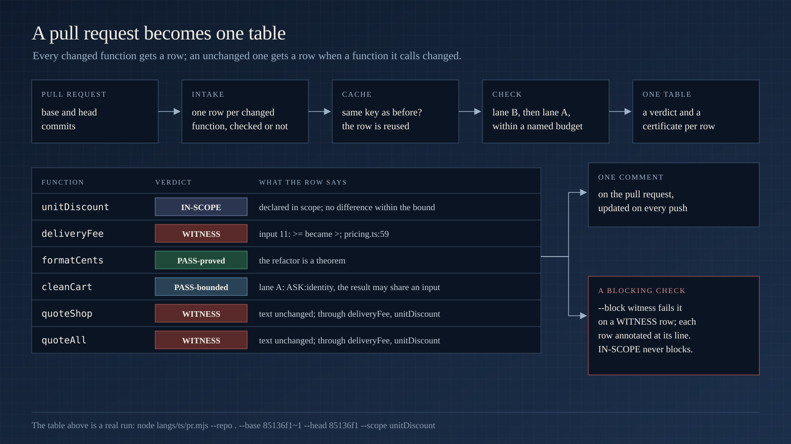
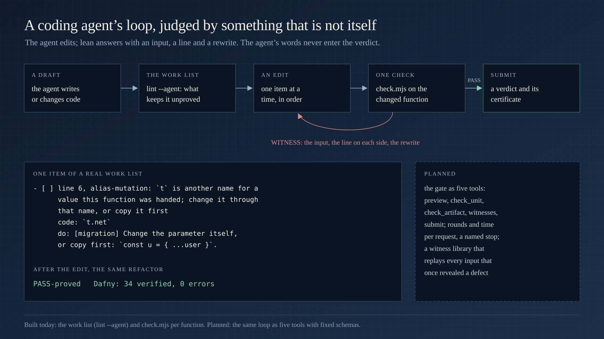

<p align="center">
  
</p>

<p align="center">
  <a href="#how-it-works">How it works</a> · <a href="#the-verdicts">Verdicts</a> · <a href="#what-it-reads">What it reads</a> · <a href="#use-cases">Use cases</a> · <a href="#writing-code-lean-can-prove">Writing provable code</a> · <a href="#using-it">Using it</a> · <a href="#what-is-built-and-what-is-planned">Built and planned</a> · <a href="#limits">Limits</a>
</p>

---

**lean is a differential equivalence checker.** Give it the old version and the new version of a function, and the scope of what was meant to change. It decides whether the two behave the same everywhere else: by proof when it can, by exhaustive exploration when the state is finite, by execution when it must, and it says which.

Every change to a program is a claim: *I changed this, and nothing else.* Tests sample that claim. Review guesses at it. lean checks it, and hands back a certificate that anyone can re-run.

- **Nothing to rewrite.** It reads your TypeScript as it is, inside its project: the `tsconfig.json`, the imports, the types. No annotations, no wrapper library, no build step.
- **Nothing to trust.** Every verdict carries the hashes of both sides, the theorem and the prover version, or the inputs, the seed and the bound. No verdict comes from a model's opinion; no `assume` anywhere a proof can see.
- **Whole programs, not toy functions.** Services with injected ports, async pipelines, exceptions across calls, classes, generators, references into shared objects, Map and Set cells, timers, React components with hooks, effects and children.

TypeScript is the first language. The core (the theorem, the checker, the certificate, the conformance suite) is language-agnostic; each language adds a lint, a translator and an execution harness under `langs/`, and merges when it passes the same conformance run. Python is at its first milestone ([`langs/py/subset.md`](langs/py/subset.md)).

```bash
git clone https://github.com/NexusGPT/lean && cd lean     # node ≥ 20 for lane B; python3 and dafny ≥ 4 (brew install dafny) for the proof lane
node langs/ts/check.mjs --parent langs/ts/tests/pairs/readme_ledger/parent.ts --candidate langs/ts/tests/pairs/readme_ledger/candidate.ts --unit applyAll --no-project --n 60
```

```
WITNESS   input 12   where: { field: "outcome" }
parent:    { returned: { posted: 2, rejected: [], total: -98 } }
candidate: { returned: { posted: 0, rejected: ["line one\nline two: below floor", "v6z8n: below floor"], total: -100 } }
```

That is a ledger function whose candidate rejects an event that lands exactly on the floor (`<=` where the parent had `<`). lean drew the input itself: one account at a negative balance, two credits that bring two new accounts exactly to the floor. The parent posts both and notifies the port twice; the candidate posts nothing. The whole example, with the five other functions of the file, is [below](#1-one-function-in-a-service-the-back-end).

## How it works

<p align="center"></p>

- **The lint decides what has a reading.** A function is inside the subset when every construct in it has a meaning as mathematics. Otherwise the lint names the construct, its line, and what to write instead; the function still runs in lane B.
- **Lane B runs both versions** in one process against the same recording fakes, on inputs drawn from the parameter types, boundary values first. It compares what each call returns or throws, the objects it reached, the ordered effects and the pending work. A difference is a `WITNESS`, with the input.
- **Lane A proves them equal.** Both sides become Dafny; every effect is a step of an explicit world, so two reads of a clock are two steps and never "equal by accident". One lemma per changed function says: outside the scope, `f_parent(x) == f_candidate(x)` for every input and every world. Dafny and Z3 decide it.
- **A component finite by its types** is explored on every click order from every prop value, to the end of its state space. The full account (what "equal" means, the certificate, how a function that calls a changed function is judged) is [`docs/how-it-works.md`](docs/how-it-works.md).

## The verdicts

<p align="center"></p>

`check.mjs` reports the strongest verdict the evidence supports: `WITNESS`, then `PASS-proved`, `PASS-decided`, `PASS-bounded`, `ASK`. A bounded pass never becomes a proof. Two more sit outside the order: `REFUSE` (a construct with no faithful reading, or a local import that cannot load) and `NEW` (a function with no parent, run with no equality claim).

## What it reads

TypeScript as written: records, arrays, tuples, strings, Map and Set, optionals and unions, generics; loops, `switch`, labelled `break`, recursion, generators; `try`/`catch`/`finally` and throws across calls; `async`/`await`, `.then` chains, `Promise.all`; classes with fields, getters, statics and decorators; callbacks and functions as values; parameters a function changes, read as outputs; timers on a virtual clock; dynamic `import()`; React components with hooks, effects, context and Tailwind classes. Each construct is read **exact** (a Dafny value of the same meaning), as a **transition** (a step of the world), **uninterpreted** (the same unknown on both sides), **opaque** (one step named by its text), or **refused** by name. What stays refused, because no value model keeps the meaning: `eval` and `new Function`, the prototype chain, `super` as a value, `===` on two objects, a change through an alias of a parameter. The area table is in [`docs/how-it-works.md`](docs/how-it-works.md#what-it-reads); every construct, with its reading and an example, is in [`langs/ts/subset.md`](langs/ts/subset.md).

## Use cases

Every output below is a real run of this checkout. The pairs live under [`langs/ts/tests/pairs/`](langs/ts/tests/pairs/) and [`examples/booking/`](examples/booking/), and the suite checks them on every commit.

### 1. One function in a service (the back end)

A ledger: events are applied to balances held in a `Map`, each posting is notified to a port, bad events are rejected with a reason, and a class keeps a running count across calls.

```ts
export interface Port { notify(account: string, balance: number): void; audit(line: string): void; }
export type Event = { account: string; kind: "credit" | "debit"; amount: number };
export type Summary = { posted: number; rejected: string[]; total: number };

export function applyAll(balances: Map<string, number>, events: Event[], port: Port, floor: number): Summary {
  const rejected: string[] = [];
  let posted = 0;
  for (const e of events) {
    if (e.amount <= 0) { rejected.push(`${e.account}: non-positive amount`); continue; }
    const before = balances.get(e.account) ?? 0;
    const after = e.kind === "credit" ? before + e.amount : before - e.amount;
    if (after < floor) { rejected.push(`${e.account}: below floor`); continue; }
    balances.set(e.account, after);
    port.notify(e.account, after);
    posted += 1;
  }
  let total = 0;
  for (const v of balances.values()) total += v;
  port.audit(`${posted} posted, ${rejected.length} rejected`);
  return { posted, rejected, total };
}

```

Beside it, `statement` (the lines of one account), `rollback` (which throws on an unknown account) and a class `Ledger` with a running count. The candidate changes five things, the way a real commit does: one slip (`<=` for `<` in `applyAll`), one changed contract (`rollback` no longer throws on an unknown account), three refactors. Each function run with `--n 60 --dafny-seconds 30`:

| function | verdict | what the certificate says |
|---|---|---|
| `applyAll` | **WITNESS** | input 12: `posted: 2` against `posted: 0`; the parent calls `notify` twice, the candidate never |
| `statement` | **PASS-proved** | the loop with `continue` became a `filter` and a `map`: `Equal_statement: true`, `5 verified, 0 errors` |
| `rollback` | **WITNESS** | input 0: the parent `threw: Error "unknown account credit"`, the candidate `returned: 0` |
| `Ledger.post` | **WITNESS** | its own text is a refactor, but it calls the changed `applyAll`: input 7, `posted: 3` against `posted: 2`, and the receiver's `count` differs |
| `Ledger.reset` | **PASS-proved** | the old count read through a local: `Equal_ledger_reset: true`, `1 verified, 0 errors` |
| `Ledger.posted` | **PASS-proved** | untouched: `1 verified, 0 errors` |

**Impact:** the reviewer reads two rows, not five changes. The three refactors are theorems; the slip comes with the input and the effect that differs, including in a method whose own text looks harmless.

### 2. A pull request

<p align="center"></p>

[`examples/booking/`](examples/booking/) is a pricing core and a quote service. Commit `85136f1` changed it the way a real pull request does: one asked rule (percent promotions capped at half the unit price), one slip while there (`>=` became `>` in the free-delivery test), two refactors.

```
$ node langs/ts/pr.mjs --repo . --base 85136f1~1 --head 85136f1 --scope unitDiscount
```

> 4 changed function(s); 5 unchanged caller(s) checked through lane B, 2 with a WITNESS through a changed callee: **1 in scope · 3 WITNESS · 1 PASS-proved · 0 PASS-decided · 1 PASS-bounded · 0 ASK · 0 REFUSE · 0 NEW**

**Impact:** the asked rule is reported `IN-SCOPE`; the slip nobody asked for is a `WITNESS` at `pricing.ts:59`, and so are the two callers whose text never changed. A test suite passes this pull request unless one of its tests sits exactly on the threshold. Intake, budgets and reuse across pushes: [`docs/pull-requests.md`](docs/pull-requests.md).

**In CI**, [`langs/ts/ci/comment.mjs`](langs/ts/ci/) posts the pull-request table as one comment, updated on every push, and the reusable workflow [`.github/workflows/lean-pr.yml`](.github/workflows/lean-pr.yml) runs it from a caller of a few lines. `--block witness` fails the check on a `WITNESS` row and annotates it at its line; `IN-SCOPE` never blocks. Every refusal of a run is also a JSON record in `.lean/runs/<identity>.refusals.json`, and `--inline` posts each as a review comment at its lines, skipping a range that already carries one. The workflow is validated offline and has not yet run on a GitHub runner ([`langs/ts/design/ci.md`](langs/ts/design/ci.md)).

### 3. In the editor

The lint is the program that admits a function to the proof lane, so the editor underlines exactly what the proof will refuse, with the rewrite labelled `[proved]`, `[conditional: <precondition>]` or `[migration]`. The ESLint plugin ([`langs/ts/eslint`](langs/ts/eslint)) ships it as one rule, `lean/provable`. It also names every `any` with the type its uses need:

```
$ node langs/ts/lint/lint.mjs quote.ts --any-type
quote.ts:3:38  any-type  `plan` is any (written); its uses say { seats: number; tier: string }
quote.ts:6:9  any-type  `seats` is any (inferred); its uses say number
```

**Impact:** code written with the rule on is provable from its first line. More (labels, the review rules under `--advice`, the census of a whole repository): [`docs/editor-and-agents.md`](docs/editor-and-agents.md).

### 4. The front end

<p align="center"></p>

A search box with a debounced filter behind a toggle ([`langs/ts/tests/pairs/readme_search/`](langs/ts/tests/pairs/readme_search/)):
```tsx
export function Search({ items, limit }: { items: string[]; limit: number }) {
  const [q, setQ] = useState("");
  const [open, setOpen] = useState(false);
  const [hits, setHits] = useState<string[]>([]);
  useEffect(() => {
    const t = setTimeout(() => setHits(items.filter((x) => x.startsWith(q)).slice(0, limit)), 200);
    return () => clearTimeout(t);
  }, [q, items, limit]);
  return (
    <div>
      <input value={q} onChange={(e) => setQ(e.target.value)} />
      <button onClick={() => setOpen(!open)}>{open ? "hide" : "show"}</button>
      {open && <ul>{hits.map((h) => <li key={h}>{h}</li>)}</ul>}
    </div>
  );
}
```

The candidate keeps one hit too many (`slice(0, limit + 1)`). One render is identical: the list is closed. The difference needs the show click, then the effect's timer firing on the virtual clock, then a settle:

```
$ node langs/ts/check.mjs --parent readme_search/parent.tsx --candidate readme_search/candidate.tsx --unit Search --no-project --n 60 --dafny-seconds 30
WITNESS -> search.json
patch: 1 insert
  div[2]/ul[0] insert <li key="vefqj">"vefqj"</li>
# witness: { input: 1, sequence: ["div[1]:onClick"] }
```

**Impact:** a bug three steps deep, behind a click and a timer, reported as the one element that differs. A component finite by its types is decided on every click order; more layers (children to a depth, resolved Tailwind styles): [`docs/front-end.md`](docs/front-end.md).

### 5. A coding agent's loop

<p align="center"></p>

An agent that writes code needs a judge that is not itself. Today it has the lint's work list (`--agent`, mutations first), `check.mjs` per function, and a `WITNESS` that carries the source line of the first differing effect on each side with the advised rewrite. **Impact:** the agent fixes against an input it can replay, and its own account of the change never enters the verdict.

### 6. Another language

Python is the second language, at its first milestone: typed functions, dataclasses and plain classes over ints, strings, lists, tuples, dicts and optionals, with calls into the outside as transitions and raised exceptions as faults. [`langs/_template/`](langs/_template/) is the start point for the next.

## Around lean

lean is one check inside a larger, mostly planned architecture: a ledger of obligations both lanes share, four worlds (frameworks, concurrency, the front end, refactors) it threads one contract at a time, and a gate that would use it as one of six checks. That layer is a higher level of abstraction, so it lives on its own page: [`docs/around-lean.md`](docs/around-lean.md).

## Writing code lean can prove

The rule in one line: **a function owns what it creates, and everything else flows through its arguments, its result, and the world.** Code written that way gets more than a test: the next change to it is a theorem. Three pairs: a function written the usual way, then the same function written lean-style. Each version then gets the same later refactor (`*.next.ts`), and lean checks that refactor on both. Every check ran with `--no-project --n 30 --dafny-seconds 30`; the `#` lines are read from the certificate. The six files are under [`examples/showcase/`](examples/showcase/); the commands run from that folder.

**1. A cart: change what you were handed through its own name, not a second one.** `addLine(cart: Cart, price: number): number`; the refactor computes the new total once (`const net = … + price`) and returns it.
```ts
// usual/cart.ts                              // lean/cart.ts
const t = cart.totals;                        cart.totals.net += price;
t.net += price;                               cart.totals.lines += 1;
t.lines += 1;                                 return cart.totals.net;
return t.net;
```
```
$ node langs/ts/lint/lint.mjs usual/cart.ts --advice
usual/cart.ts:6:3  alias-mutation  `t` is another name for a value this function was handed; change it through that name, or copy it first
usual/cart.ts:7:3  alias-mutation  `t` is another name for a value this function was handed; change it through that name, or copy it first
$ node langs/ts/check.mjs --parent usual/cart.ts --candidate usual/cart.next.ts --unit addLine
PASS-bounded -> usual-cart.json      # lanes.A: ASK, translate: outside the subset (alias-mutation)
$ node langs/ts/lint/lint.mjs lean/cart.ts --advice
lean/cart.ts: inside the subset
$ node langs/ts/check.mjs --parent lean/cart.ts --candidate lean/cart.next.ts --unit addLine
PASS-proved -> lean-cart.json        # lanes.A: Equal_add_line: true; Dafny: 34 verified, 0 errors
```
**Impact:** the refactor is proved for every cart, not sampled on 30 inputs; the same refactor with the `lines` update forgotten is a `WITNESS`.

**2. A booking: write an effect under a condition as a branch, not an expression.** `confirm(b: Booking, late: boolean): number`; the refactor computes the price before the note (`const price = b.nights * b.rate`) and returns it.
```ts
// usual/booking.ts                           // lean/booking.ts
late && b.notes.push("late arrival");         if (late) b.notes.push("late arrival");
return b.nights * b.rate;                     return b.nights * b.rate;
```
```
$ node langs/ts/lint/lint.mjs usual/booking.ts --advice
usual/booking.ts:4:3  unsupported-syntax  only assignments, ++/--, calls, and await may stand as statements
$ node langs/ts/check.mjs --parent usual/booking.ts --candidate usual/booking.next.ts --unit confirm
PASS-bounded -> usual-booking.json   # lanes.A: ASK, translate: outside the subset (unsupported-syntax)
$ node langs/ts/lint/lint.mjs lean/booking.ts --advice
lean/booking.ts: inside the subset
$ node langs/ts/check.mjs --parent lean/booking.ts --candidate lean/booking.next.ts --unit confirm
PASS-proved -> lean-booking.json     # lanes.A: Equal_confirm: true; Dafny: 1 verified, 0 errors
```
**Impact:** nobody re-reads whether moving a line above the note changed anything. The branch returns its world only when taken, so the reordering is a theorem.

**3. A ledger: build a dictionary as a value, not by writing keys into it.** `index(accounts: Account[]): Record<string, Account>`; the refactor turns the loop into `accounts.forEach((a) => { … })` with the same body.
```ts
// usual/ledger.ts                            // lean/ledger.ts
const byId: Record<string, Account> = {};     let byId: Record<string, Account> = {};
for (const a of accounts) byId[a.id] = a;     for (const a of accounts) byId = { ...byId, [a.id]: a };
return byId;                                  return byId;
```
```
$ node langs/ts/lint/lint.mjs usual/ledger.ts --advice
usual/ledger.ts:5:29  prototype  a key that may be '__proto__' with an object or null value replaces the dictionary's prototype (the setter of Object.prototype.__proto__) and makes no key; write `d = { ...d, [k]: v }`, which makes an own key, or use a Map
$ node langs/ts/check.mjs --parent usual/ledger.ts --candidate usual/ledger.next.ts --unit index
PASS-bounded -> usual-ledger.json    # lanes.A: ASK, translate: outside the subset (prototype)
$ node langs/ts/lint/lint.mjs lean/ledger.ts --advice
lean/ledger.ts: inside the subset
$ node langs/ts/check.mjs --parent lean/ledger.ts --candidate lean/ledger.next.ts --unit index
PASS-proved -> lean-ledger.json      # lanes.A: Equal_index: true; Dafny: 13 verified, 0 errors
```
**Impact:** an account whose id is `__proto__` can no longer replace the dictionary's prototype behind the code, and the loop rewritten as `forEach` needs no review: it is proved equal.

Everything else is yours: `async`/`await`, `try`/`catch`, `switch`, destructuring, optional chaining, `Map`, `Set`, generics, recursion, callbacks to array methods, classes, JSX. The habits one by one, with what each buys: [`docs/writing-provable-code.md`](docs/writing-provable-code.md).

## Using it

| | command |
|---|---|
| one function, both lanes, one verdict with its certificate | `node langs/ts/check.mjs --parent old.ts --candidate new.ts --unit applyDiscount` (`--unit Class.method`; `--scope scope.json`; `--n`, `--seed`, `--dafny-seconds`, `--deep[=k]`, `--out verdict.json`) |
| a whole pull request, one table | `node langs/ts/pr.mjs --repo <checkout> --base <ref> [--head <ref>] [--scope f,Class.m] [--preview] [--time-budget <s>] [--unit-budget <n>] [--out report.md]` |
| lane B alone, in seconds | `node langs/ts/exec/run.mjs --parent old.ts --candidate new.ts --unit f` |
| the lint, in the terminal or an agent's loop | `node langs/ts/lint/lint.mjs file.ts [--json \| --agent] [--any-type] [--advice]` |
| the lint, in the editor | `import lean from 'lean/langs/ts/eslint/index.mjs'`, rule `lean/provable` |
| the pull-request comment and gate | `node langs/ts/ci/comment.mjs --repo <checkout> --base <sha> --head <sha> [--post] [--block none\|witness\|ask]` |
| the suite | `node langs/ts/tests/run.mjs` · `python3 -I conformance/run.py` |

**Lane B needs only Node** (fast-check is vendored under `langs/ts/vendor` with its licence). Dafny and Python are needed for the proof lane; without them lane A reports `ASK` and the verdict is lane B's. `check.mjs` exits 0 on every verdict and 2 when a run ends with no verdict; `lint.mjs` exits 1 on findings.

## What is built and what is planned

| capability | status |
|---|---|
| the two lanes, the finite lane, the certificate, the readings in [`subset.md`](langs/ts/subset.md) | built; the suite pins every reading with a pair test |
| the pull-request table with a row per changed function, `--preview`, budgets, reuse across pushes; a `WITNESS` that names the source line on each side | built; the reuse key stops at one import level |
| the lint, its editor rule, labelled advice, a proposal for every `any` declaration | built; `any` inside a type is not reported yet |
| the front-end layers: a tree to a stated depth with context, resolved Tailwind styles with the project's theme | built |
| the CI comment and block flag | built, validated offline, not yet run on a GitHub runner |
| the gate around lean, the gate as tools for a coding agent ([`docs/around-lean.md`](docs/around-lean.md)), a public benchmark run | planned |
| more languages through the conformance suite | Python at its first milestone |

Every row lands only with the suite green and the regression table at or above its floor. A piece whose table shows a drop is reworked or dropped, never argued.

## Limits

lean says `ASK` rather than guess. Today it asks on: a `while` loop with no measure it can derive, a loop reshaped into a different loop when its body does more than guard and push, a result that may share an input (`ASK:identity`), a suspended render, two asynchronous schedules racing beyond the explored bound, a changed signature without a declared adapter (`ASK:interface`), and code the repository does not contain.

Lane B's bound is real: a frozen world, generated inputs, click sequences to a stated depth. Its word is `PASS-bounded`, and it stays that word. Pixels, layout and the accessibility tree are never judged, and the certificate says so. Measured figures live under [`langs/ts/design/`](langs/ts/design/), each with its date and the commit it was measured at.

## Repository layout

```
langs/ts/check.mjs · pr.mjs · census.mjs   one function; a pull request; a repository's reach
langs/ts/lint/ · eslint/ · ci/             the subset gate and its advice; the editor rule; the CI comment
langs/ts/translate/ · exec/                TypeScript to Dafny (lane A); fakes, inputs, runner, clock (lane B)
langs/ts/SEMANTICS.md · subset.md          what "equal" means; every construct and its reading
langs/ts/design/ · tests/pairs/            one note per reading; the pair tests that pin each verdict
spec/theorem.py · conformance/             the theorem; one command for every language and fixture
examples/booking/ · docs/                  a pricing core in lean style; diagrams and long forms
langs/py/ · langs/_template/               Python; how to add a language
```

## Contributing

A language merges when it passes `python3 -I conformance/run.py`: every shared fixture translates to the same form, every escape is refused, no clean change is refused. For TypeScript, `node langs/ts/tests/run.mjs` must stay green; a new construct comes with a pair test under `langs/ts/tests/pairs/`, a design note under `langs/ts/design/` and a row in `langs/ts/subset.md`.

Rules that bind every contribution: no verdict from a model; no `assume`, no `{:axiom}`, no `{:verify false}` anywhere a proof can see; a bounded result is never reported as a proof; every mechanism is general, never a case for one bug.

## License

Apache-2.0.
